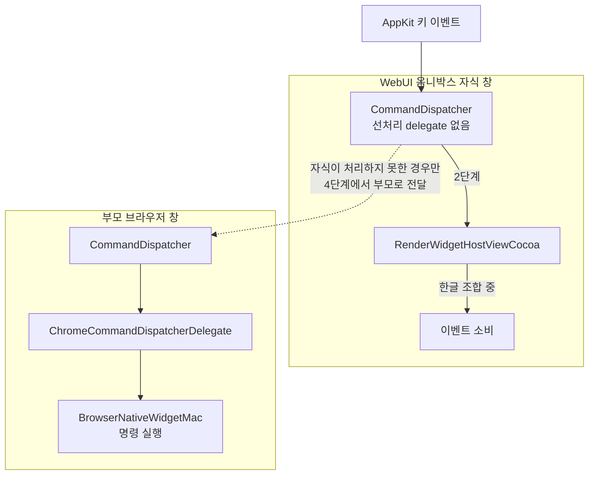
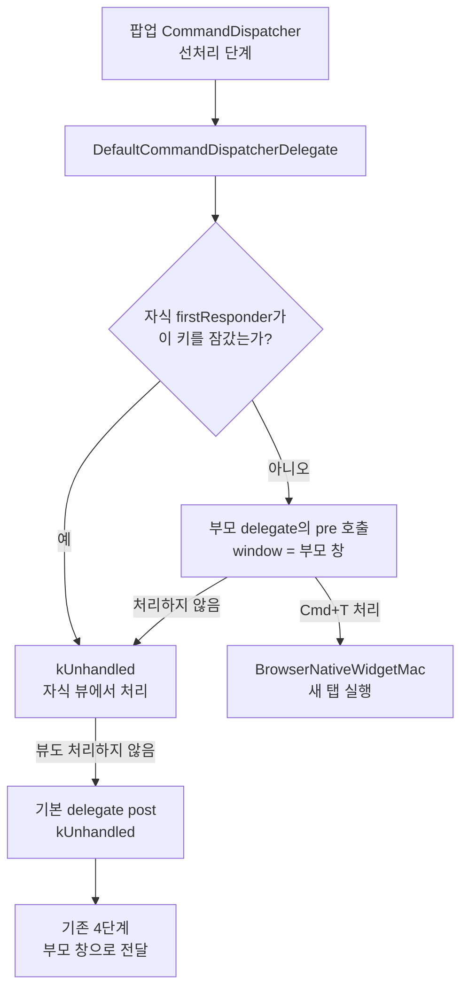

import Callout from "@/components/Callout.astro"

이 글은 제가 직접 작성한 [Chromium 기여 기록](https://ossca-chromium.github.io/contributions/patches/8350946/)을 바탕으로, 문제를 발견하고 수정안을 바꿔 간 과정을 블로그 글로 다시 정리한 것이다.

## 이슈를 찾게 된 배경

해당 이슈가 chromium issue 페이지에 등록이 되어있던 것은 아니었다. 이와 유사한 이슈가 하나 등록이 되어있었는데, 실제 로컬에서 테스트, dev, canari 버전의 크롬으로 테스트를 해봤을 때 문제가 없어서 해당 이슈를 진행하지 않고 다른 이슈를 찾아봐야지 했었다.

그런데 그냥 우연히 omnibox 에서 한글을 입력하면서 cmd+t를 눌렀는데 새 탭이 열리지 않았다. 정확히는 한번에 열리지 않고, 그 다음 한번 더 누르니 그 때 반응을 하였다. 이게 의도된 동작인지 궁금해서 `WebUIOmniboxPopup` 를 활성화 하지 않은 (정확히는 flag 를 on 하지 않고) 일반적인 크롬에서 테스트해 본 결과 한글로 입력되더라도 곧바로 반응하였다.

즉, 이러한 동작은 의도된 동작이 아님을 알 수 있었고, chromium issue tracker 에 이슈를 등록하게 되었다.

<Callout theme="note" title="Omnibox란?">
  참고로 주소와 검색어를 한곳에서 입력하는 Chrome의 주소창을 **Omnibox**라고 부른다. [Chromium Omnibox 소개](https://www.chromium.org/user-experience/omnibox/)
</Callout>

## 문제를 재현한 환경

`WebUIOmniboxPopup`과 `WebUIOmniboxFullPopup`을 활성화한 macOS Chromium에서 첫 커멘드 입력이 무시되는 현상을 발견하고, 이에 대한 [이슈를 등록했다](https://issues.chromium.org/issues/556432989).

FullPopup은 입력 행까지 WebUI로 만들고 키보드 포커스를 받는 **별도 자식 창**이다. 따라서 브라우저의 부모 창에서 명령을 처리하는 흐름과, 팝업 창의 입력 뷰가 이벤트를 받는 흐름을 함께 봐야 했다.

## 키 이벤트는 어떤 순서로 전달될까?

macOS의 `CommandDispatcher`는 단축키를 대략 다음 순서로 처리한다. `firstResponder`는 해당 창에서 현재 키보드 포커스를 가진 객체다. [CommandDispatcher 계약](https://chromium.googlesource.com/chromium/src/+/b43f1a7f4665e08050ba4e3c695cce734656defc/ui/base/cocoa/command_dispatcher.h)

| 순서            | 처리 지점               | 역할                                                   |
| --------------- | ----------------------- | ------------------------------------------------------ |
| 1. 선처리(pre)  | 창의 delegate           | 예약 명령과 우선순위가 높은 단축키를 뷰보다 먼저 처리  |
| 2. 기본 처리    | `firstResponder`        | 입력 필드나 웹 콘텐츠가 이벤트를 처리                  |
| 3. 후처리(post) | 창의 delegate           | 뷰가 처리하지 않은 명령을 처리                         |
| 4. 부모 전달    | `commandDispatchParent` | 자식 창에서 끝내 처리하지 못한 이벤트를 부모 창에 전달 |

`Cmd+T`는 1단계에서 처리해야 하는 예약 명령이다. 그런데 팝업 창에는 이 선처리를 맡을 delegate가 없었다. 이벤트가 2단계의 `RenderWidgetHostViewCocoa`로 넘어갔고, 한글 조합 중 입력 처리 경로가 이를 소비했다. 그러면 4단계의 부모 전달까지 도달하지 않는다. 첫 입력으로 조합이 끝나고 나서야 다음 누름이 부모 창에 닿을 수 있었던 것이다.

즉, **부모에게 전달하는 기능이 없었던 것이 아니라 전달 순서가 늦었다.**

## 수정안이 바뀐 이유

먼저 수정 전 창들의 관계를 보면 문제 지점이 분명해진다. 팝업의 `CommandDispatcher`에는 선처리 delegate가 없어서 키가 자식 뷰로 먼저 간다. 부모 브라우저에는 명령을 해석하고 실행할 수 있는 delegate와 host가 있지만, 자식에서 처리하지 않은 이벤트만 나중에 전달받는다.



위 경로에서는 한글 조합 중 `RenderWidgetHostViewCocoa`가 키를 소비하면 부모 브라우저 창의 실행자까지 갈 수 없다. 또한 delegate가 받는 `window`가 팝업이면 Chrome 명령을 실행할 수 없는 일반 `NativeWidgetMac`에 연결되므로, **어느 창을 인자로 넘기는지도 중요하다.**

처음에는 팝업에도 Chrome 명령을 처리하는 `ChromeCommandDispatcherDelegate`를 설치했다. `Cmd+T`는 고쳐졌지만, 같은 delegate의 post 처리까지 팝업에서 실행되면서 다른 문제가 생겼다. `Cmd+1` 같은 명령은 팝업의 일반 `NativeWidgetMac`에서 실행할 수 없다.

다음에는 `CommandDispatcher`의 선처리 경로에서 부모의 pre를 먼저 호출하도록 바꿨다. 명령 실행을 부모 브라우저 창에 남길 수 있었지만, 자식 뷰의 **Keyboard Lock**을 부모가 알지 못해 잠긴 키를 앞질러 처리하는 회귀가 드러났다. 부모에게 맡기기 전에 자식 `firstResponder`의 잠금 상태를 확인하도록 보완했다.

최종 CL은 이 동작을 `DefaultCommandDispatcherDelegate`로 분리했다. 범용 자식 창에는 기본 delegate를 설치하고, 브라우저 창에는 기존 Chrome 전용 delegate를 유지한다. 기본 delegate는 다음처럼 움직인다. [최종 CL](https://chromium-review.googlesource.com/c/chromium/src/+/8350946), [고정 코드](https://chromium.googlesource.com/chromium/src/+/b43f1a7f4665e08050ba4e3c695cce734656defc/ui/base/cocoa/default_command_dispatcher_delegate.mm)

1. 자식 창의 `firstResponder`가 해당 키를 잠갔다면 처리하지 않고 뷰에 돌려준다.
2. 그렇지 않으면 `commandDispatchParent`의 delegate에 **부모 창을 인자로** 전달해 pre를 호출한다.
3. 기본 delegate의 post는 처리하지 않고 기존 부모 전달 단계에 맡긴다.

최종 흐름은 다음과 같다. 새 delegate는 **부모 선처리만 자식 뷰보다 앞에 놓고**, 자식 뷰와 기존 후처리·부모 전달 순서는 유지한다.



흐름도의 잠금 확인과 부모 선처리는 당시 작성한 `DefaultCommandDispatcherDelegate`의 다음 코드에 해당한다. 팝업의 키가 잠겨 있으면 `kUnhandled`를 반환해 자식 뷰에 맡기고, 그렇지 않으면 **부모 창을 `window` 인자로** 부모 delegate의 pre에 전달한다. [고정 코드 원문](https://chromium.googlesource.com/chromium/src/+/b43f1a7f4665e08050ba4e3c695cce734656defc/ui/base/cocoa/default_command_dispatcher_delegate.mm)

```objc
- (ui::PerformKeyEquivalentResult)prePerformKeyEquivalent:(NSEvent*)event
                                                   window:(NSWindow*)window {
  NSResponder* responder = window.firstResponder;
  if ([responder respondsToSelector:@selector(isKeyLocked:)] &&
      [(id)responder isKeyLocked:event]) {
    return ui::PerformKeyEquivalentResult::kUnhandled;
  }

  if (![window conformsToProtocol:@protocol(CommandDispatchingWindow)]) {
    return ui::PerformKeyEquivalentResult::kUnhandled;
  }

  NSWindow<CommandDispatchingWindow>* dispatching_window =
      static_cast<NSWindow<CommandDispatchingWindow>*>(window);
  NSWindow<CommandDispatchingWindow>* parent =
      dispatching_window.commandDispatchParent;
  return [[parent commandDispatcher].delegate prePerformKeyEquivalent:event
                                                               window:parent];
}
```

이 delegate의 post는 `kUnhandled`를 반환한다. 자식 뷰도 처리하지 않은 이벤트는 기존 `CommandDispatcher`의 `[_owner.commandDispatchParent performKeyEquivalent:event]` 경로로 올라간다. [부모 전달 코드](https://chromium.googlesource.com/chromium/src/+/b43f1a7f4665e08050ba4e3c695cce734656defc/ui/base/cocoa/command_dispatcher.mm)

Chrome 명령은 브라우저 창의 실행자에서 처리할 수 있지만 범용 팝업 창의 실행자는 그렇지 않다. 최종안은 자식의 입력 소유권을 확인하고, 실제 Chrome 명령 실행은 부모에 맡긴다. 기본 delegate는 `NativeWidgetMacNSWindow`에 설치되며 창이 강하게 참조한다. [delegate 설치 코드](https://chromium.googlesource.com/chromium/src/+/b43f1a7f4665e08050ba4e3c695cce734656defc/components/remote_cocoa/app_shim/native_widget_mac_nswindow.mm)

해당 변경을 기반으로 실제 main 브런치에 병합이 되었으며, 추후 google QA팀으로 부터 실제 문제가 없는지 확인하기 위해 여러가지 테스트를 진행했고, 해당 변경이 문제가 없음이 확인 되었다.

## 익숙치 않은 환경이었지만

이전에 잘못된 판단으로 CL 이 반려당한 경험이 있었고, 해당 작업은 꽤나 큰 작업이었는데 언어마저 잘 알지 못하는 object c 기반으로 진행했어야 해서 지속적으로 신중한 결정을 하기 위해 노력하였다.

AI가 해석 후 특정 코드를 구현할 때, 항상 요구했던 지시는 2가지였다.

- 이 구현의 의도는 무엇이고 현 이슈를 확실히 해결하는 과정인지, 그리고 코드의 논리성을 체크하기 위해 같이 코드 리뷰를 진행하자.
- 현 변화가 현 모듈이나 파일의 책임에 있어서 규칙을 벗어나지 않는지, 불필요하게 확장한 코드가 없는지 반복 체크를 진행하자.

구현된 코드를 같이 해석하면서 논리적인 흐름을 항상 파악하면서 문제가 될 만한 사항들은 지속적으로 수정을 요청했었다. 문제를 해결하는 코드가 가장 중요했지만, 이후 해당 변경이 오직 '이 문제만을 해결 하기 위한 수정' 인지를 지속적으로 체크를 했는데,

- 왜 이렇게 문제가 될 수 있는 코드를 이전 개발자는 작성을 했는지(history)
- 지금의 변경이 현 모듈이나 함수가 가지는 방향성에 어긋나는 수정이 아닌지
- 지금의 변경이 다른 부분에 문제를 일으키는 수정이 아닌지, 그리고 그 문제가 실제 다른 모듈의 동작을 해쳐 테스트 코드를 실패하는 것 뿐 아니라, 구현의 방향성에서도 어긋남이 없는지

위와 같은 질문들은 AI 의 구현사항을 점검할 때 정말 중요했던 부분인데, 이러한 체크가 없는 경우 AI 는 그럴듯 하게 코드 구현을 진행하지만, 정말 맥락 없는 코드가 되는 경우가 많아서 이렇게 업로드 할 시 리뷰어에게 지적을 당할 수 있고 반려 뿐 아니라 큰 고민없이 AI에게 책임을 위임한 작업임을 드러내는 것이 되어 chromium 의 기여 규칙에도 적합하지 않다.

그리고 이렇게 여러번 체크를 하면서 단위 테스트, wpt 테스트, 실제 content_shell 을 실행하면서 테스트를 거쳐서 업로드 했을 때도, 리뷰어는 현 변경보다 delegate 를 추가하는 방향이 더 적합한 맥락적 흐름이라고 설명해주었다. 수정 전 `CommandDispatcher`에도 선처리의 주체를 명시한 주석이 있었다. [수정 전 코드](https://chromium.googlesource.com/chromium/src/+/8c20b7cc99efe98a7e375e4b1e742fd4a5cfbc78/ui/base/cocoa/command_dispatcher.mm#119)

```objc
// First, give the delegate an opportunity to consume this event.
ui::PerformKeyEquivalentResult result =
    [_delegate prePerformKeyEquivalent:event window:_owner];
```

이 주석이 기본 delegate를 추가하라고 직접 지시하는 것은 아니다. 다만 자식 뷰보다 먼저 키를 처리할 기회를 **delegate에 준다**는 기존 책임을 보여준다. [리뷰어는 그 구조를 유지하면서](https://chromium-review.googlesource.com/c/chromium/src/+/8350946/2/ui/base/cocoa/command_dispatcher.mm#151) 부모로의 선처리를 `DefaultCommandDispatcherDelegate`에 넣자고 제안했다. 여러 차례 점검했어도 이 코드베이스의 맥락을 놓쳤다는 점에서 AI와 함께 검토할 때도 여전히 확인할 것이 많다고 느꼈다.

그럼에도 불구하고 이렇게 절차를 거쳐서 진행하였기에 리뷰를 거칠 수 있을만한 코드가 업로드 될 수 있었고, 성공적으로 이슈를 수정할 수 있었다.

이슈의 발견부터 수정 및 병합, 테스트까지 진행 된 완결성이 있는 기여라 포스팅을 남겨본다.

## 관련 기록과 코드

- [직접 작성한 Chromium 기여 기록: Route reserved shortcuts from child windows](https://ossca-chromium.github.io/contributions/patches/8350946/)
- [Chromium 이슈 #556432989](https://issues.chromium.org/issues/556432989)
- [병합된 Chromium CL #8350946](https://chromium-review.googlesource.com/c/chromium/src/+/8350946)
- [최종 기본 delegate 코드](https://chromium.googlesource.com/chromium/src/+/b43f1a7f4665e08050ba4e3c695cce734656defc/ui/base/cocoa/default_command_dispatcher_delegate.mm)
