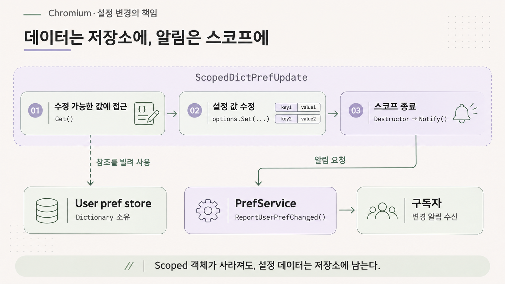
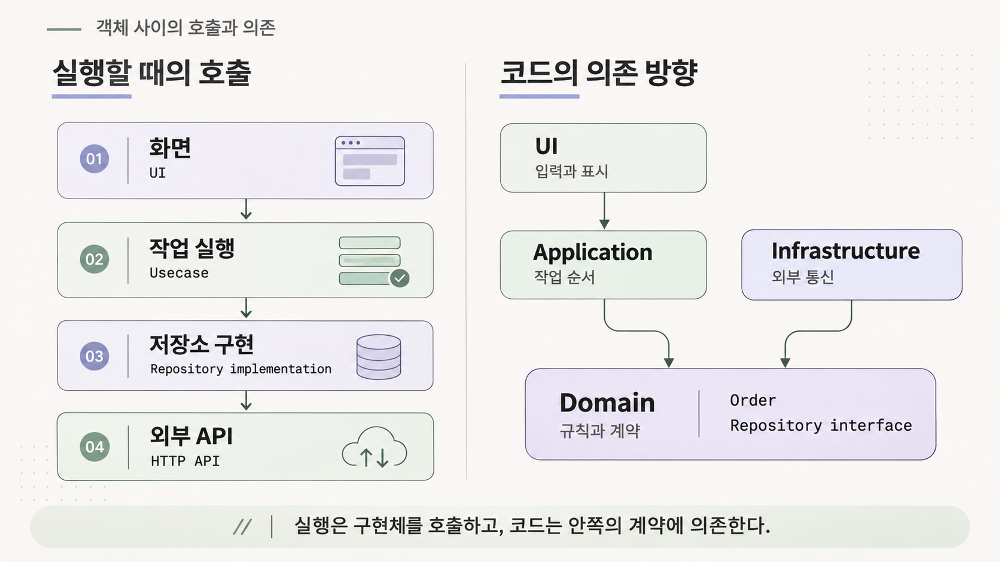

import Callout from '@/components/Callout.astro';

## 회사에서 서버와 동일한 아키텍쳐를 유지해달라는 제안을 받았었다

회사 합류 초기, 회사 내 학원관리자나 기존 학원 대시보드 등의 서비스의 화면은 퍼블리싱 수준의 데모 화면이었었다. 프론트엔드 개발자로 합류하자 마자 전체 서비스의 리펙토링을 진행하게 되었는데, 당시 CTO 님께서는 서버와 동일한 아키텍쳐를 프론트엔드에서도 유지해주길 바라셨었는데, 이에 익숙치 않지만 '이게 실제 프로덕션 레벨의 설계일까' 라는 일종의 기대감과 호기심으로 설계를 진행했던 기억이 난다.

서버는 typescript (node.js) 기반의 도메인 주도 설계(DDD)를 기반으로 더 빠르게 구조를 잡아가고 있었고, CTO님께서는 사용하는 언어 자체가 동일하니 백엔드와 프론트엔드가 각자의 서비스 코드를 리뷰하는데 더 수월할 수 있고, 공통된 언어로 소통하는것이 개발팀 그리고 기획팀, 디자인팀 까지 효율적일 수 있다고 판단하셨던것 같다.

실제로 매 스크럼 마다 회의를 진행할 때, 어느정도 도메인에 대한 통일된 언어로 회의를 진행하다보니 각 팀의 이해도가 상승된 부분은 있었다.

문제라면 프론트엔드의 현재 프레임워크 기반 컴포넌트 구성과 도메인 주도 설계를 적합하게 조합시키는 것이 쉽진 않았던 기억이 난다. 분명 엄격한 레이어 분리와 함수의 책임, 의존 강도에 있어서 많은 개선을 가져왔지만, class 기반의 설계에서 실제 화면까지 이어지는 상태 관리가 쉽지 않았었다.

엄격한 만큼 유연한 화면 구성을 할 수 없었던 것이었을까? 아니면 내가 여전히 객체지향 패턴이 미숙해 '한계처럼' 느껴졌던 것이었을까?

시간이 지나, C++ 의 객체에 대해서 스터디를 할 수 있었고 이 기회에 한번 더 돌이켜 보는 것도 좋겠다 싶었다.

## C++의 객체지향은 무엇을 표현하려는 걸까?

C++의 클래스를 처음 배우면 멤버 변수와 멤버 함수, 접근 지정자 같은 문법부터 만나게 된다. 이 문법을 실제 서비스에 적용하려고 하면 고민할 것이 더 생긴다. **어떤 데이터를 하나의 객체로 보고, 그 데이터에 관한 어떤 행동을 객체의 책임으로 둘 것인지**부터 정해야 하기 때문이다.

그림판을 만든다고 생각해보자. 화면에는 점과 사각형이 있고, 사용자는 도형을 만들거나 크기를 바꾼다. 점은 좌표를 가지고, 사각형은 두 점으로 자신의 영역을 표현할 수 있다. 크기를 바꾸는 행동은 이 좌표들과 밀접하게 연결된다.

이처럼 연관된 데이터와 그 데이터를 기반으로 동작하는 기능을 하나의 단위로 구조화하는 데 클래스와 구조체를 사용할 수 있다. 그리고 객체들이 서로 행동을 요청하며 협력하도록 서비스의 구조를 잡을 수 있다. 현실의 개념을 데이터와 기능으로 연결된 객체들의 관계로 표현해보는 것이다.

같은 사각형도 그림판에서는 편집과 선택이 중요하고, 다른 서비스에서는 면적 계산만 필요할 수 있다. 그래서 **서비스에서 필요한 모델과 그 모델이 책임질 행동을 고르는 과정**에 연습이 필요하다고 느꼈다. 클래스 문법을 익힌 뒤에는 이렇게 서비스의 요구사항을 객체의 책임으로 옮겨보는 공부가 이어져야 할 것 같다.

> **클래스를 작성하는 것에서 더 나아가, 어떤 객체가 어떤 데이터를 책임지고 어떤 행동으로 협력할지 설계해야 한다.**

### 구조체와 클래스는 문법적으로 무엇이 다를까?

C++의 `struct`와 `class`는 모두 생성자, 멤버 변수, 멤버 함수를 가질 수 있다. 차이는 기본 멤버 접근 권한과 기본 상속 접근 권한이다. `struct`는 `public`, `class`는 `private`이 기본이다.

```cpp
struct Point {
    int x = 0; // 기본적으로 public
    int y = 0;

    void moveTo(int next_x, int next_y) {
        x = next_x;
        y = next_y;
    }
};

class PointClass {
    int x_ = 0; // 기본적으로 private
    int y_ = 0;

public:
    void moveTo(int next_x, int next_y) {
        x_ = next_x;
        y_ = next_y;
    }
};
```

`struct`에도 `private`을 쓸 수 있고, `class`에도 `public`을 쓸 수 있다. 두 문법 모두 데이터와 행동을 묶을 수 있으니, 어떤 의도로 묶는지를 함께 보면 좋다.

설계의 의도를 표현하는 관례도 있다. C++ Core Guidelines의 C.2는 멤버들이 서로 독립적으로 변할 수 있다면 `struct`를, 함께 지켜야 할 불변식이 있다면 `class`를 사용하도록 권한다. 중요한 것은 키워드 자체보다 **멤버 사이에 보호해야 할 관계가 있는지**다.

## 그림판의 좌표를 누구나 바꿀 수 있다면

이 글의 그림판에서는 사각형을 왼쪽 위와 오른쪽 아래의 두 점으로 표현하고, 너비와 높이는 항상 양수여야 한다고 정해보자. 화면 좌표는 오른쪽으로 갈수록 `x`, 아래로 갈수록 `y`가 커진다고 가정한다.

```text
topLeft.x < bottomRight.x
topLeft.y < bottomRight.y
```

사각형의 너비와 높이는 두 점의 좌표 차이로 결정된다. 따라서 두 점의 위치 관계를 함께 확인해야 한다.

### Before: 내부 좌표를 열어둔 경우

다음 예시는 앞의 `Point`와 별도로 비교하기 위한 코드다.

```cpp
struct Point {
    int x;
    int y;
};

struct Rectangle {
    Point topLeft;
    Point bottomRight;

    int width() const {
        return bottomRight.x - topLeft.x;
    }
};

Rectangle rectangle{{10, 10}, {100, 80}};

// 도형 편집 코드가 왼쪽 위의 x만 변경했다.
rectangle.topLeft.x = 120;

// 너비가 -20이 되어 사각형의 조건을 깨뜨린다.
int width = rectangle.width();
```

드래그 이벤트, 속성 패널, 키보드 이동 기능이 모두 좌표를 직접 바꿀 수 있다면 각 기능이 같은 조건을 알아야 한다. 한 곳에서 검사를 빠뜨리면 다른 곳에서 유효하지 않은 사각형을 받는다.

좌표를 `private`으로 옮겨도 `Point& topLeft()`처럼 내부 점의 수정 가능한 참조를 반환하면 우회 경로가 다시 열린다. getter가 있다는 사실보다 **그 getter가 내부 상태를 어디까지 변경할 수 있게 하는지**를 봐야 한다.

### After: 사각형이 두 점의 관계를 보호하는 경우

점은 자신의 좌표를 표현하고, 사각형은 자신이 가진 두 점의 관계를 보호하게 바꿔보자. 아래 역시 독립된 예시다.

```cpp
#include <stdexcept>

class Point {
private:
    int x_;
    int y_;

public:
    Point(int x, int y) : x_(x), y_(y) {}

    int x() const { return x_; }
    int y() const { return y_; }
};

class Rectangle {
private:
    // 외부에서는 이 두 점을 직접 바꿀 수 없다.
    Point top_left_;
    Point bottom_right_;

public:
    Rectangle(Point top_left, Point bottom_right)
        : top_left_(top_left), bottom_right_(bottom_right) {
        // 오른쪽 아래가 왼쪽 위보다 오른쪽·아래에 있어야 한다.
        if (bottom_right.x() <= top_left.x() ||
            bottom_right.y() <= top_left.y()) {
            throw std::invalid_argument("Invalid rectangle");
        }
    }

    bool resize(Point next) {
        // 잘못된 좌표라면 기존 상태를 그대로 둔다.
        if (next.x() <= top_left_.x() || next.y() <= top_left_.y()) {
            return false;
        }

        bottom_right_ = next;
        return true;
    }

    // 내부 점 대신 복사본을 돌려준다.
    Point bottomRight() const { return bottom_right_; }
};
```

생성자는 처음부터 잘못된 사각형이 만들어지는 것을 막는다. 이후에는 `resize()` 안에서 새 좌표를 확인하고, 조건을 만족할 때만 오른쪽 아래 점을 바꾼다.

<Callout theme="note" title="은닉화와 캡슐화는 어떻게 연결될까?">
  이 글에서는 관련 데이터와 행동을 책임 단위로 묶는 것을 캡슐화로, 외부에서
  의존하지 않아도 되는 구현과 상태 변경 경로를 감추는 것을 정보 은닉으로
  구분한다. 불변식은 그 단위가 계속 지켜야 할 조건이다. 접근 지정자는 이를
  구현하는 도구이고, 어떤 조건을 어디에서 보호할지는 설계의 문제다.
</Callout>

## 상태를 고치는 대신 행동을 요청한다

도형 편집 도구에서는 새 좌표를 `resize()`에 전달하고 성공 여부를 확인하면 된다. 사각형의 내부 좌표를 하나씩 수정하던 코드를 행동 하나로 묶은 셈이다.

```cpp
// 편집 도구는 크기 변경을 요청한다.
bool resized = rectangle.resize(Point{140, 100});
```

나중에 사각형의 내부 표현을 두 점에서 시작점과 너비·높이로 바꿀 수도 있다. **공개한 `resize()`의 의미와 결과를 유지한다면 호출자는 그 저장 방식을 따라 바뀔 필요가 없다.**

주문에서도 같은 구분을 할 수 있다. 아래 첫 코드는 상품 수 조회와 완료 상태 변경을 외부에 열어둔 설계를 가정한다.

```cpp
// 호출자가 주문 완료 규칙과 변경 절차를 모두 알고 있다.
if (order.itemCount() > 0 && !order.isCompleted()) {
    order.setCompleted(true);
}

// 규칙을 주문 객체에 맡기면 호출자는 행동을 요청한다.
order.complete();
```

`complete()` 안에서는 상품 존재 여부와 현재 상태를 검사한다. 규칙이 추가되면 주문 객체의 처리 방식을 수정한다. 요청의 의미가 유지되는 한, 화면이나 다른 모듈은 같은 메시지를 보낼 수 있다.

이런 관점을 Tell, Don't Ask라고 부르기도 한다. 화면에서는 주문 상태를 읽어 표시하고, 주문을 완료할 때는 `complete()`에 판단을 맡긴다. **조회한 값을 사용하는 일과, 그 객체의 규칙을 대신 판단하는 일을 구분하면** 책임을 어디에 둘지 생각하기가 조금 수월하다.

내가 객체지향에서 특히 중요하게 보게 된 부분도 여기에 있다. 각 객체가 자기 책임을 수행하고, 객체 사이에서는 약속된 메시지로 협력한다. 앞의 `resize()`나 `complete()` 같은 메서드 호출을 통해 다른 객체에 행동을 요청하는 것이다.

상태를 직접 읽고 쓰는 코드가 여러 호출부에 퍼져 있으면 규칙을 바꿀 때마다 수정할 곳을 찾아야 한다. 행동의 책임을 객체에 모으면 그 규칙을 한곳에서 관리할 수 있으니, **변경의 영향 범위를 줄이고 내부 표현에 대한 의존을 낮출 수 있다.**

## Redux의 dispatch에서도 비슷한 경계를 볼 수 있다

이 관점으로 프론트엔드를 보면 Redux의 상태 변경 방식이 익숙하게 보인다. 화면이 Store의 데이터를 직접 수정하는 대신 action을 전달하고, reducer가 다음 상태를 결정한다. 내가 앞의 객체지향 예시와 연결해서 보게 된 부분은 **변경을 요청하는 쪽과 수행하는 쪽의 경계**였다.

```typescript
import { configureStore, createSlice } from '@reduxjs/toolkit';

type OrderState = {
  itemCount: number;
  status: 'pending' | 'completed';
};

const orderSlice = createSlice({
  name: 'order',
  initialState: { itemCount: 1, status: 'pending' } as OrderState,
  reducers: {
    completeRequested(state) {
      // 완료 조건은 호출자가 아니라 상태 변경을 담당하는 쪽에서 확인한다.
      if (state.itemCount <= 0 || state.status !== 'pending') return;

      state.status = 'completed';
    },
  },
});

export const { completeRequested } = orderSlice.actions;

export const store = configureStore({
  reducer: { order: orderSlice.reducer },
});
```

아래 코드는 위에서 만든 Store를 직접 호출하는 예시다.

```typescript
store.dispatch(completeRequested());

console.log(store.getState().order.status); // completed
```

**화면은 완료를 요청하고, 상태 변경을 담당하는 쪽은 완료 조건을 판단한다.**

문자열 action type을 호출부마다 직접 적을 필요도 없다. `completeRequested()`가 `order/completeRequested` 타입의 action을 만들고, 해당 slice의 reducer가 완료 규칙을 적용한다.

더 구체적인 서드파티에 대한 설명보다는, 핵심은 결국 절차적인 수정이 아닌 메시지 전달을 통한 요청이다.

## Chromium은 설정 변경과 알림의 책임을 어떻게 나눌까?

C++의 실제 코드에서는 이런 경계가 어떻게 구성되어 있을까? Chromium의 `PrefService`와 `ScopedDictPrefUpdate`를 보면, 설정 저장소에 접근하는 책임과 변경을 알리는 책임을 구체적으로 살펴볼 수 있다.

### 호출자는 설정 서비스에 요청한다

`PrefService`는 설정의 조회와 변경을 위한 API를 제공한다. 호출자는 저장 파일의 위치나 내부 저장소 구현을 몰라도 정해진 키로 값을 읽고 쓸 수 있다. 사용 방식을 이해하기 위해 그림판 설정을 예로 들어보자. 아래 설정 키는 미리 등록해둔 것으로 가정한다.

```cpp
void EnableDrawingGrid(PrefService& prefs) {
    prefs.SetBoolean("drawing.grid_enabled", true);
}

bool IsDrawingGridEnabled(const PrefService& prefs) {
    return prefs.GetBoolean("drawing.grid_enabled");
}
```

화면은 그리드를 켜달라고 요청한다. 사용자 설정 저장소를 어떻게 선택하고 변경을 전달할지는 서비스 쪽의 책임이다. `PrefService`의 공개 인터페이스가 저장소와 호출자 사이의 경계가 된다. [Chromium — PrefService](https://chromium.googlesource.com/chromium/src/+/refs/heads/main/components/prefs/pref_service.h)

### Dictionary를 수정하는 동안의 책임은 Scoped 객체에 둔다

여러 필드를 가진 설정에는 `ScopedDictPrefUpdate`를 사용할 수 있다. 다음 역시 등록된 Dictionary 키를 수정하는 사용 예시다.

```cpp
#include "components/prefs/scoped_user_pref_update.h"

void UpdateDrawingPreferences(PrefService& prefs) {
    ScopedDictPrefUpdate update(prefs, "drawing.options");
    auto& options = update.Get();
    options.Set("grid_enabled", true);
    options.Set("snap_enabled", true);

    // 함수 범위를 벗어나면 update가 소멸하며 변경 알림을 처리한다.
}
```

`Get()`으로 Dictionary의 수정 가능한 참조를 받아 값을 바꾼다. 이 참조는 Scoped 객체가 살아 있는 동안 사용하고, 데이터의 소유권은 설정 저장소에 남는다. 여기서는 **값을 수정하는 동안의 접근과 수정 후의 알림을 하나의 객체가 맡는다.** [Chromium — ScopedDictPrefUpdate 선언](https://chromium.googlesource.com/chromium/src/+/refs/heads/main/components/prefs/scoped_user_pref_update.h)

### 소멸자가 후처리의 시점을 연결한다

실제 구현의 핵심만 발췌하면 다음과 같다.

```cpp
ScopedUserPrefUpdateBase::~ScopedUserPrefUpdateBase() {
    DCHECK_CALLED_ON_VALID_SEQUENCE(sequence_checker_);
    Notify();
}

void ScopedUserPrefUpdateBase::Notify() {
    if (value_) {
        value_ = nullptr;
        service_->ReportUserPrefChanged(path_);
    }
}
```

`Notify()`는 `value_`를 확인한 뒤 `PrefService`에 알림을 요청한다. **변경 전후의 값을 비교하기보다, 수정 가능한 값에 접근한 기록을 기준으로 후처리하는 구조**다. 전체 구현에서는 `GetValueOfType()`이 값을 가져오는 과정과 접근 실패 시의 진단·대체 값 처리도 담당한다. [Chromium — ScopedUserPrefUpdate 구현](https://chromium.googlesource.com/chromium/src/+/refs/heads/main/components/prefs/scoped_user_pref_update.cc)

이를 책임과 수명의 관계로 읽으면 다음과 같다.



<Callout theme="note" title="필요한 협력 객체에만 내부 접근을 허용한다">
  PrefService는 내부의 수정·알림 경로에 접근할 수 있도록 Scoped 보조 클래스에
  friend 권한을 부여한다. 외부 호출자에게 모든 구현을 공개하는 대신, 제한된 협력
  객체가 정해진 책임을 수행하도록 경계를 둔 것이다.
</Callout>

## 객체들이 자기 책임을 지킨다는 것의 장점

그림판 예시에서는 사각형이 좌표의 관계를 지켰다. 메시지를 요청하는 호출자는 저장 방식을 몰라도 됐다. Chromium에서는 설정 서비스와 Scoped 객체가 데이터 접근과 후처리를 나눴다.

이런 설계가 주는 이점은 구체적이다. 유효하지 않은 상태를 만드는 경로를 줄이고, 같은 검증을 여러 호출부에 반복하지 않게 한다. 공개 계약을 유지하며 내부 구현을 바꿀 수 있고, 협력 객체의 계약을 기준으로 테스트 대역을 넣기도 쉬워진다.

이런 장점을 얻으려면 책임을 나누는 기준도 잘 잡아야 한다. 서로 다른 이유로 바뀌는 코드를 한곳에 두면 수정이 겹치고, 항상 함께 바뀌는 코드를 너무 흩어두면 한 기능을 고치기 위해 여러 곳을 오가게 된다. 실제로 어떤 코드가 함께 바뀌는지 살펴보는 일이 필요했다.

회사에서 객체 간 소통을 중심으로 구조를 잡으려 했던 이유도 이런 장점 때문이었다. 비즈니스 용어와 규칙을 코드의 경계로 옮기고 싶었다. 하지만 그 객체들이 화면과 만나면 추가로 해결해야 할 문제가 있었다. 그 차이를 이야기하기 전에, 당시의 계층 설계가 의도했던 역할을 정리해보려 한다.

## TypeScript와 tsyringe로 의존 방향을 정했던 이유

### Entity의 구조와 행동을 공통 언어로 정한다

당시에는 각 계층이 어떤 인터페이스를 통해 소통할지 정하는 데 신경을 썼다. 그 의도를 주문 예시로 단순화하면 다음과 같다.

Entity는 식별자를 가진 도메인 개념을 표현한다. 주문이라면 주문 ID, 상품 수, 주문 상태를 같은 의미로 사용하고, 완료와 같은 행동을 통해 규칙을 지키게 할 수 있다.

```typescript
// domain/Order.ts
export type OrderSnapshot = {
  id: string;
  itemCount: number;
  status: 'pending' | 'completed';
};

export class Order {
  private state: OrderSnapshot;

  constructor(snapshot: OrderSnapshot) {
    if (
      !snapshot.id ||
      !Number.isSafeInteger(snapshot.itemCount) ||
      snapshot.itemCount < 0 ||
      !['pending', 'completed'].includes(snapshot.status) ||
      (snapshot.status === 'completed' && snapshot.itemCount === 0)
    ) {
      throw new Error('유효하지 않은 주문입니다.');
    }

    this.state = { ...snapshot };
  }

  complete() {
    if (this.state.itemCount === 0 || this.state.status !== 'pending') {
      throw new Error('완료할 수 없는 주문입니다.');
    }

    this.state = { ...this.state, status: 'completed' };
  }

  toSnapshot(): OrderSnapshot {
    return { ...this.state };
  }
}
```

이 `complete()`는 서비스의 다른 부분이 상태 문자열을 임의로 바꾸는 대신, 주문에 완료를 요청한다. 조회용 스냅샷은 복사본으로 반환한다. 값이 모두 원시값인 이 예시에서는 얕은 복사로 내부 상태와 분리된다.

### 실행 흐름과 import 방향을 구분한다

Repository는 외부 데이터 접근에 대한 계약을 제공한다. 여기서는 그 인터페이스를 Domain에 두고, 구체적인 HTTP 구현은 Infrastructure에 둔다. Repository 계약을 Application에 두는 설계도 가능하지만, 안쪽 계층이 외부 구현을 import하지 않는다는 기준은 같다.

```typescript
// domain/OrderRepository.ts
import type { Order } from './Order';

export interface OrderRepository {
  findById(id: string): Promise<Order>;
  save(order: Order): Promise<Order>;
}
```

```typescript
// application/CompleteOrder.ts
import type { OrderRepository } from '../domain/OrderRepository';

export class CompleteOrder {
  constructor(private readonly orders: OrderRepository) {}

  async execute(id: string) {
    const order = await this.orders.findById(id);
    order.complete();
    const saved = await this.orders.save(order);
    return saved.toSnapshot();
  }
}
```

Application은 주문을 가져오고, 완료를 요청하고, 저장하는 순서를 조정한다. 완료 조건은 `Order`가 판단한다. Repository에는 인터페이스로 정의한 메시지를 보낼 뿐, HTTP 클라이언트의 종류를 알지 못한다.

| 계층             | 책임                                     | import 기준                                    |
| ---------------- | ---------------------------------------- | ---------------------------------------------- |
| Domain           | Entity, 값과 규칙, Repository 계약       | UI·DI 컨테이너·HTTP 라이브러리에 의존하지 않음 |
| Application      | Usecase와 작업 순서 조정                 | Domain과 필요한 포트에 의존                    |
| Infrastructure   | Repository 구현, 외부 통신과 데이터 변환 | 안쪽의 계약을 구현하고 외부 SDK를 사용         |
| UI / Adapter     | 입력과 출력, 반응성 연결                 | Usecase와 조회 결과를 사용                     |
| Composition Root | 구현체 등록과 객체 생성                  | 각 계층을 연결하는 조립 지점                   |

> **실행 흐름과 import 방향은 다르다.** Application이 의존하는 것은 외부 구현이 아니라 안쪽에 정의한 계약이다.



실제 Repository 구현에서는 외부 응답을 검증하고 도메인 모델로 변환한다. SDK의 응답 형태나 통신 오류를 안쪽에 그대로 흘려보내지 않도록 경계를 둔다. UI가 바뀌거나 HTTP 라이브러리를 교체해도 Domain의 규칙은 유지하려는 의도다.

### 데코레이터는 객체를 연결하는 도구다

typescript 는 아쉽게도 실제 브라우저에서는 js 로 모두 변환되기에, interface 기반의 구조체 주입이 불가능하며, 생성자 내 실제 인자를 넣어주어야 한다. 이를 도와주는 라이브러리가 tsyringe인데, decorator 라는 문법(토큰같은 개념)을 통해 실제 실행 시 해당 신호에 맞게 생성자에 필요한 의존성을 등록된 구현체로 연결한다.

Domain과 Application에서 DI 라이브러리 import까지 제거하려면 데코레이터를 바깥쪽 조립 계층에 둘 수 있다. 아래는 앞의 순수한 `CompleteOrder`에 주입을 연결하는 한 가지 방법이다. `HttpOrderRepository`는 앞서 설명한 계약을 구현한 인프라 객체라고 가정한다.

```typescript
// composition/completeOrder.ts
import 'reflect-metadata';
import { container, inject, injectable } from 'tsyringe';
import { CompleteOrder } from '../application/CompleteOrder';
import type { OrderRepository } from '../domain/OrderRepository';
import { HttpOrderRepository } from '../infrastructure/HttpOrderRepository';

@injectable()
class InjectedCompleteOrder extends CompleteOrder {
  constructor(@inject('OrderRepository') orders: OrderRepository) {
    super(orders);
  }
}

container.register('OrderRepository', { useClass: HttpOrderRepository });
container.register(CompleteOrder, { useClass: InjectedCompleteOrder });

export const completeOrder = container.resolve(CompleteOrder);
```

이 구조로 비즈니스 판단을 UI와 서드파티에서 분리하고, 의존 방향을 유지하며 외부 구현을 교체할 수 있었다. 그런데 실제 화면에 데이터를 연결하는 과정에서는 또 다른 고민이 생겼다.

## 로직의 경계가 명확해도 화면의 상태는 별도 문제였다

내가 어려움을 느꼈던 지점은 Usecase를 호출한 다음이었다. 데이터를 가져온 뒤 어느 컴포넌트에 연결할지, 화면을 이동했다 돌아오면 다시 요청할지, 다른 화면에서 수정한 데이터를 언제 반영할지를 정해야 했다.

사용자는 서로 다른 경로로 진입하고, 빠르게 필터를 바꾸고, 요청이 끝나기 전에 다른 항목을 선택한다. 여러 사용자가 같은 서버 데이터를 수정할 수도 있다. 프론트엔드는 이 흐름 속에서 **현재 화면이 어떤 데이터를 구독하고 있고, 그 데이터가 얼마나 최신인지** 관리해야 한다.

초기에는 Dispatcher가 Usecase 실행과 함께 로딩을 켜고 끄는 역할을 맡았다. 하지만 요청 두 개가 겹쳤을 때 하나의 boolean으로 충분한지, 이전 요청이 늦게 끝나 최신 화면을 덮어쓰지는 않는지, 같은 데이터를 여러 컴포넌트가 요청할 때 캐시를 공유할지 같은 정책이 뒤따랐다.

Usecase와 Repository로 로직을 나눈 뒤에도 이런 작업이 계속 남았다. 도메인 객체는 자신이 가진 상태를 유효하게 유지하지만, 화면에서는 그 상태를 언제 읽고 다시 가져와야 할지까지 정해야 했다.

> **객체의 책임을 나누고 내부 규칙을 보호한 뒤에도, 프론트엔드에서는 그 상태를 화면에 전달하고 서버와 동기화하는 설계가 추가로 필요했다.**

객체지향 중심의 설계를 적용하며 어려웠던 부분을 돌아보면, 상태 변경을 화면에 알리는 일, 서버 데이터와 맞추는 일, 화면마다 다른 상태의 수명, 실행 환경 사이의 데이터 전달로 나눠볼 수 있을 것 같다.

## 객체 안에서 변경을 끝내도 화면은 알아야 한다

앞의 주문 객체는 `complete()`를 실행하면 자신의 상태를 바꾼다. 이제 그 주문을 표시하는 상세 화면과 목록이 있다면, 두 화면에도 변경을 전달해야 한다. 프레임워크가 어떤 계산을 다시 해야 하는지 알아야 하기 때문이다. 브라우저의 DOM 갱신, 레이아웃, 페인트에는 비용이 들고, 그 전에 실행하는 컴포넌트와 파생 데이터 계산에도 비용이 있다. 불필요한 작업을 줄이려면 변경을 알아차릴 수 있는 경로가 필요하다.

이때 React가 컴포넌트를 실행해 결과를 계산하는 과정과, 그 결과를 DOM에 반영하는 과정으로 나눠보면 이해하기 쉽다. 컴포넌트를 다시 실행해도 DOM 결과가 같다면 DOM 변경이 없을 수 있다. **렌더 횟수 자체보다 어떤 계산과 DOM 작업이 발생하는지** 살펴봐야 한다.

### 조용한 내부 변경은 UI에 전달되지 않는다

```typescript
class Counter {
  #value = 0;

  increment() {
    this.#value += 1;
  }

  get value() {
    return this.#value;
  }
}
```

```tsx
const [counter] = useState(() => new Counter());

return <button onClick={() => counter.increment()}>{counter.value}</button>;
```

클릭하면 객체의 값은 바뀐다. 하지만 이 코드에는 React에 업데이트를 요청하는 경로가 없다.

> **객체 내부의 규칙을 지키는 것과, UI가 그 변경을 관찰할 수 있게 하는 것은 별도의 책임이다.**

```tsx
const [count, setCount] = useState(0);

return <button onClick={() => setCount((prev) => prev + 1)}>{count}</button>;
```

React에서는 setter로 다음 값을 전달하고, 객체 상태는 기존 값을 직접 고치기보다 새 값으로 교체하는 방식이 기본이다. 이전 스냅샷을 유지하고 참조를 비교할 수 있어 변경 판단과 최적화에 활용할 수 있다. 객체를 복사할 때도 변경된 부분을 새로 만들고 나머지는 공유할 수 있다. [React — Updating Objects in State](https://react.dev/learn/updating-objects-in-state)

<Callout theme="note" title="은닉화와 불변성은 서로 다른 기준이다">
  은닉화는 접근과 책임의 경계를 다루고, 불변성은 기존 값의 변경 여부를 다룬다.
  캡슐화된 메서드 안에서도 기존 값을 바꾸거나 새 값으로 교체하는 방식을 선택할
  수 있다. 새 스냅샷을 만들고 구독자에게 알리면 내부 상태를 보호하면서 UI에도
  변경을 전달할 수 있다.
</Callout>

Vue에서는 Proxy 기반 추적을 사용하고, React에서는 외부 Store의 구독과 스냅샷을 `useSyncExternalStore`로 연결할 수도 있다. [React — useSyncExternalStore](https://react.dev/reference/react/useSyncExternalStore)

이런 방식을 선택하면 도메인 객체를 유지하면서 UI에 연결할 수 있다. 대신 객체에서 어떤 스냅샷을 제공할지, 변경을 누구에게 알릴지, 화면이 사라질 때 구독을 어떻게 해제할지 정해야 한다. **객체 내부의 메서드를 완성한 뒤에도 화면과 연결하는 코드가 한 겹 더 필요해지는 것이다.**

## 화면에 있는 주문은 서버에서 이미 바뀌었을 수 있다

주문 상세 화면에서 `order.complete()`를 호출했다고 가정해보자. 같은 주문이 목록에도 표시되고 있다면 그 목록에는 어떤 상태가 보일까?

화면마다 별도의 `Order` 인스턴스를 만들었다면 상세 화면의 변경을 목록에도 전달해야 한다. 하나의 인스턴스를 공유하면 두 화면의 상태를 맞추기 쉬워지지만, 이제 그 객체를 어디에 보관하고 언제 다시 조회할지 정해야 한다. 다른 사용자가 서버에서 주문을 수정한 경우에도 브라우저의 객체를 갱신할 방법이 필요하다.

여기서 주문 객체가 가진 완료 규칙과 별도로 **현재 상태가 서버의 어느 시점과 일치하는지**를 관리해야 한다. 클라이언트의 규칙 검사로 버튼을 제어하더라도, 최종 변경은 서버에서 현재 상태와 권한을 확인한 뒤 처리해야 한다.

요청이 겹치는 상황도 생각해볼 수 있다. 사용자가 주문 A를 선택한 직후 B를 선택했는데, A의 응답이 더 늦게 도착할 수 있다. 화면의 상태를 응답이 도착한 순서대로 대입하면 B를 선택한 화면에 A의 데이터가 보일 수 있다. 응답이 어떤 요청의 결과인지 구분하고, 현재 화면에 반영할지를 판단하는 과정이 필요하다.

객체 사이의 호출 관계만으로 설계를 마치기 어려웠던 이유도 여기에 있었다. 객체가 수행할 행동에 더해, **요청 결과를 어디에 보관하고 어떤 화면에 전달할지 정해야 했다.** 조회 결과를 키로 구분하고, 캐시를 공유하고, 변경 후 관련 데이터를 다시 조회하는 정책이 함께 필요했다.

## 같은 주문도 화면마다 필요한 상태와 수명이 다르다

서버에서 가져온 주문을 수정하는 폼을 생각해보자. 사용자가 상품 수를 바꾸고 있지만 아직 저장하지 않은 상태다. 이때 목록과 편집 폼이 하나의 가변 주문 객체를 공유하면, 입력할 때마다 목록에도 저장 전의 값이 보일 수 있다.

반대로 서버의 최신 데이터를 같은 객체에 반영하면 사용자가 입력하던 값이 덮어써질 수 있다. 그래서 편집 중인 값은 따로 두고, 저장을 완료했을 때 서버의 응답으로 조회 데이터를 갱신하는 구성을 생각할 수 있다.

```text
서버에서 조회한 주문 → 상세 화면과 목록이 읽는 캐시
편집 중인 주문      → 저장하거나 편집을 취소할 때까지 유지하는 폼 상태
선택한 탭·팝업     → 해당 화면을 사용하는 동안 유지하는 UI 상태
```

모두 같은 주문 화면에 필요한 데이터지만, 바뀌는 시점과 유지할 기간이 다르다. DI로 생성한 서비스가 화면보다 오래 살아 있다면, 그 서비스에 넣은 선택 상태나 로딩 상태를 언제 초기화할지도 정해야 한다.

객체에 연관 데이터를 모을 때는 도메인에서의 관계를 먼저 생각했다. 그런데 화면에서는 **같은 주문에 관한 데이터도 조회용 상태와 편집 중인 상태로 나누고, 각각의 수명을 관리해야 했다.** 이 차이를 하나의 객체 안에 넣으려 할수록 화면별 상태와 갱신 정책까지 그 객체가 맡게 된다.

이 때문에 서버 상태, 폼 상태, 일시적인 UI 상태를 나눠 다루는 편이 자연스러웠다. 도메인 객체를 사용하더라도 어떤 상태를 그 객체에 넣고, 어떤 상태를 화면이나 캐시에 둘지 별도로 판단해야 했다.

## 서버에서 전달받는 것은 데이터이고, 행동은 다시 연결해야 한다

객체 중심으로 모델을 구성하면 외부에서 가져온 데이터를 그 모델로 만드는 과정도 필요하다. 일반적인 JSON API를 통해 전달되는 것은 직렬화한 데이터다. 클래스의 메서드나 프로토타입은 파싱 결과에 함께 복원되지 않는다.

```typescript
class User {
  constructor(public name: string) {}

  greet() {
    return `Hello, ${this.name}`;
  }
}

const parsed = JSON.parse(JSON.stringify(new User('Kim')));

console.log(parsed.name); // Kim
console.log(parsed instanceof User); // false
console.log(parsed.greet); // undefined
```

이 값을 `User`의 행동과 함께 사용하려면 클라이언트에서 인스턴스를 만들어야 한다. 앞의 주문 예시에서도 API 응답을 검증해 `Order`로 만들고, 화면이나 캐시에 넘길 때는 `toSnapshot()`으로 데이터를 꺼내는 과정이 생긴다.

클라이언트의 여러 화면에서 주문 규칙을 사용한다면 모델로 변환하는 비용을 들일 이유가 있다. 반면 서버에서 검증한 주문을 읽어 표시하는 화면이라면, 필요한 데이터를 받아 표현하는 구성이 간결할 수 있다. **어떤 행동을 실제로 클라이언트에서 수행하는지에 따라 모델을 복원할 범위도 달라진다.**

서버 컴포넌트에서도 같은 경계를 만난다. 서버에서 `Order`를 사용했더라도 클라이언트 컴포넌트에는 스냅샷을 전달해야 한다. React의 전송 형식은 `Date`, `Map`, Server Function 참조 등을 지원하지만, 사용자 정의 클래스 인스턴스와 일반 함수를 그대로 props로 전달하는 것은 지원하지 않는다. [React — 직렬화 가능한 props](https://react.dev/reference/rsc/use-client#serializable-types-returned-by-server-components)

내부의 도메인 모델, 캐시에 보관할 데이터, 화면이 구독할 상태를 연결하는 작업이 이렇게 여러 경계에서 반복된다. 객체 중심으로 전체 프론트엔드를 구성하면 이 변환과 연결까지 직접 설계하게 된다. 단순 조회 화면에서도 이 과정을 모두 거치면, 도메인 규칙을 보호해서 얻는 이점에 비해 작성할 코드가 많아질 수 있다.

## 객체지향과 함수형을 함께 사용하는 실무적 구성

회사에서 느꼈던 어려움은 이 추가 작업들을 어디에 둘지 결정하는 과정이었다. Dispatcher에 로딩과 오류 처리를 넣기 시작했지만, 화면 간 공유와 재조회까지 다루려면 요청 상태를 관리하는 규칙이 더 필요했다.

여기서 도메인 규칙을 다루는 구조는 유지하고, 화면의 구독과 서버 상태 관리는 그 문제를 다루는 도구에 맡기는 방향을 생각할 수 있다. **객체의 책임 경계를 유지하면서도, 화면에는 데이터와 변경 요청을 연결하는 함수를 제공하는 것이다.**

내가 선택하고 싶은 방향은 각 문제에 맞게 두 방식을 조합하는 것이다. **도메인 객체는 규칙을 지키고, Usecase는 작업을 조정하고, UI를 위한 어댑터는 관찰과 비동기 상태를 연결한다.** 데이터 변환은 입력과 출력이 분명한 함수로 두고, 요청과 저장 같은 부수 효과는 실행하는 계층을 정해두면 각 부분을 이해하고 테스트하기도 수월해진다.

### Usecase는 유지하고 요청 상태의 관리를 옮긴다

앞의 주문 예시를 Vue 화면에 연결해보자. `getOrder.execute()`는 조회한 주문의 스냅샷을 반환하고, `completeOrder.execute()`는 앞서 정의한 완료 Usecase다. 두 객체는 조립 지점에서 구성해 전달받는다고 가정한다.

```typescript
import { useMutation, useQuery, useQueryClient } from '@tanstack/vue-query';
import { computed, toValue, type MaybeRefOrGetter } from 'vue';
import type { OrderSnapshot } from './domain/Order';

type GetOrder = {
  execute(id: string): Promise<OrderSnapshot>;
};

type CompleteOrder = {
  execute(id: string): Promise<OrderSnapshot>;
};

export function useOrder(
  id: MaybeRefOrGetter<string>,
  getOrder: GetOrder,
  completeOrder: CompleteOrder
) {
  const queryClient = useQueryClient();
  const key = computed(() => ['order', toValue(id)] as const);

  const query = useQuery({
    queryKey: key,
    queryFn: ({ queryKey }) => getOrder.execute(queryKey[1]),
    staleTime: 30_000,
  });

  const completion = useMutation({
    mutationFn: (orderId: string) => completeOrder.execute(orderId),
    onSuccess: (saved) => {
      queryClient.setQueryData(['order', saved.id], saved);
    },
  });

  return { query, completion };
}
```

앞에서 직접 정해야 했던 요청 상태와 캐시 연결을 Composable과 TanStack Query에 맡긴 구성이다. Domain과 Application은 기존 역할을 유지하고, 화면은 조회 결과와 요청 상태를 구독한다. Dispatcher마다 로딩과 오류 상태를 구현하던 부분도 이 경계로 옮길 수 있다.

조회 ID가 바뀌면 query key도 바뀌도록 반응형 입력을 유지했다. 값을 미리 문자열로 꺼내 전달해버리면 그 연결을 잃을 수 있다. `queryFn`도 자신에게 주어진 key의 ID로 요청한다.

주문 완료는 `completion.mutate(order.id)`처럼 조작 시점의 ID를 전달한다. 응답이 늦게 도착해 화면의 선택 ID가 바뀌어도, 저장 결과는 `saved.id`에 해당하는 캐시에 반영한다. 조회·변경 중 표시와 오류는 `query`와 `completion`의 상태로 표현하고, 도메인 규칙은 여전히 Usecase와 Entity에 남긴다.

여기서는 `staleTime`을 30초로 설정해 그동안 캐시를 신선한 데이터로 취급한다. 시간이 지난 뒤에는 마운트·포커스·재연결 등의 조건에 따라 다시 조회한다. 서비스에 따라 폴링이나 실시간 이벤트로 갱신 시점을 정할 수도 있다.

위 예시는 주문 상세 캐시 하나만 다룬다. 주문 목록이나 집계도 영향을 받는 서비스라면 관련 캐시를 함께 무효화해야 한다. 앞서 시작한 조회가 저장 응답 뒤에 도착하는 경우까지 고려한다면 취소와 재검증 정책도 필요하다. 책임을 라이브러리에 옮겨도 **어떤 데이터가 서로 영향을 주는지 정하는 일은 애플리케이션에 남는다.**

### TanStack Query 내부에서도 클래스와 Hook은 함께 쓰인다

객체를 UI에 연결하려면 구독과 수명을 관리할 코드가 필요하다고 앞에서 이야기했다. TanStack Query 내부에는 이 역할을 맡는 `QueryObserver` 클래스가 있다. 이 객체는 관찰할 Query와 현재 결과, 구독에 관한 상태를 가지고 메서드로 관리한다.

```typescript
import { QueryObserver } from '@tanstack/query-core';

const observer = new QueryObserver(queryClient, {
  queryKey: ['order', 'order-1'],
  queryFn: () => fetchOrder('order-1'),
});

const stop = observer.subscribe((result) => {
  renderStatus(result.status);
});

// 관찰이 끝난 시점에 구독을 해제한다.
stop();
```

`QueryObserver`는 내부적으로 Query에 관찰자를 연결하고, 구독자가 사라지면 타이머와 관찰 관계를 정리한다. 상태와 행동, 수명을 가진 객체의 역할이 남아 있다. [TanStack Query — QueryObserver 소스](https://github.com/TanStack/query/blob/main/packages/query-core/src/queryObserver.ts)

React 어댑터의 `useBaseQuery`는 Observer 인스턴스를 유지하면서 `subscribe()`와 `getCurrentResult()`를 `useSyncExternalStore`에 연결한다. 호출자는 `useQuery()`로 상태를 읽지만, 그 아래에서는 객체가 관찰과 알림을 관리한다. [TanStack Query — useBaseQuery 소스](https://github.com/TanStack/query/blob/main/packages/react-query/src/useBaseQuery.ts)

```text
컴포넌트: useQuery로 관찰 결과를 읽음
    ↓
React 어댑터: 구독과 스냅샷을 React에 연결
    ↓
QueryObserver 객체: 결과 계산과 구독 수명 관리
    ↓
Query / Cache: 요청 결과와 서버 상태 관리
```

이 구조를 보니 실무에서도 비슷한 방식으로 조합해볼 수 있겠다는 생각이 들었다. **내부에서 상태와 구독을 관리하는 객체를 두고, 화면에는 Hook으로 관찰 결과를 제공하는 것이다.** 객체가 맡을 책임과 프레임워크에 연결할 부분을 나눠보는 데 참고할 만한 사례였다.

## 다시 객체지향을 프론트엔드에서 생각하면

C++을 공부하면서 객체의 책임과 수명을 언어가 얼마나 직접적으로 표현해주는지 느낄 수 있었다. TypeScript에서도 클래스와 생성자를 사용할 수 있지만, C++에서는 생성과 소멸에 자원의 확보와 정리를 연결할 수 있다. Chromium의 Scoped 객체처럼 소멸 시점에 후처리를 맡기는 설계를 보면, **객체의 수명까지 설계에 담는 데에는 C++이 더 직접적인 언어 기능을 제공한다**는 생각이 들었다.

그렇다고 객체지향을 C++이라는 언어 안에서만 이해할 필요는 없을 것 같다. 연관된 데이터와 행동을 묶고, 각 객체가 자신의 책임을 수행하며 협력하도록 바라보는 관점은 TypeScript에서도 적용할 수 있다. 회사에서 계층과 의존 방향을 나눴던 경험도 같은 관점에서 다시 이해할 수 있었다.

> **객체지향은 모든 문제를 푸는 마스터 키가 아니라, 문제를 바라보고 구조를 잡는 하나의 시야다.**

많은 개발자가 오랫동안 사용하고 검증해온 설계 방식인 만큼 배울 점이 많다. 동시에 그 방식을 적용할 환경과 해결하려는 문제도 살펴봐야 한다. 객체지향이라는 이유만으로 좋은 설계라고 받아들이기보다, 지금의 요구사항에서 어떤 이점을 얻고 어떤 비용을 감수하는지 생각해야 한다고 느꼈다.

프론트엔드에서는 특히 렌더링 최적화와 상태의 흐름이 중요하다. 객체가 내부 규칙을 잘 지키는 것에 더해, 프레임워크가 변경을 관찰하고 필요한 화면 작업으로 연결할 수 있어야 한다. 서버 데이터의 갱신이나 화면마다 다른 상태의 수명도 함께 고려해야 한다. 이런 조건을 보면 도메인 객체를 유지할 곳과, 데이터와 행동을 나누어 다룰 곳을 판단할 수 있다.

이번 공부를 통해 얻은 것도 그 판단 기준에 가까웠다. 앞으로는 익숙한 설계 방식을 먼저 정해두기보다, **지금의 환경에서는 어떤 시각으로 문제를 바라보는 것이 더 적합할지**부터 생각해보고 싶다. 객체지향으로 책임을 묶는 방식과 함수로 데이터의 흐름을 표현하는 방식을, 각각 도움이 되는 곳에 사용할 수 있으면 좋겠다.

## References

- [C++ Core Guidelines — C.2](https://isocpp.github.io/CppCoreGuidelines/CppCoreGuidelines#Rc-struct)
- [Redux Toolkit — createSlice](https://redux.js.org/toolkit/api/createSlice)
- [Chromium — PrefService](https://chromium.googlesource.com/chromium/src/+/refs/heads/main/components/prefs/pref_service.h)
- [Chromium — ScopedUserPrefUpdate 선언](https://chromium.googlesource.com/chromium/src/+/refs/heads/main/components/prefs/scoped_user_pref_update.h)
- [Chromium — ScopedUserPrefUpdate 구현](https://chromium.googlesource.com/chromium/src/+/refs/heads/main/components/prefs/scoped_user_pref_update.cc)
- [TSyringe — Dependency Injection Container](https://github.com/microsoft/tsyringe)
- [TanStack Query — QueryObserver 소스](https://github.com/TanStack/query/blob/main/packages/query-core/src/queryObserver.ts)
- [TanStack Query — useBaseQuery 소스](https://github.com/TanStack/query/blob/main/packages/react-query/src/useBaseQuery.ts)
