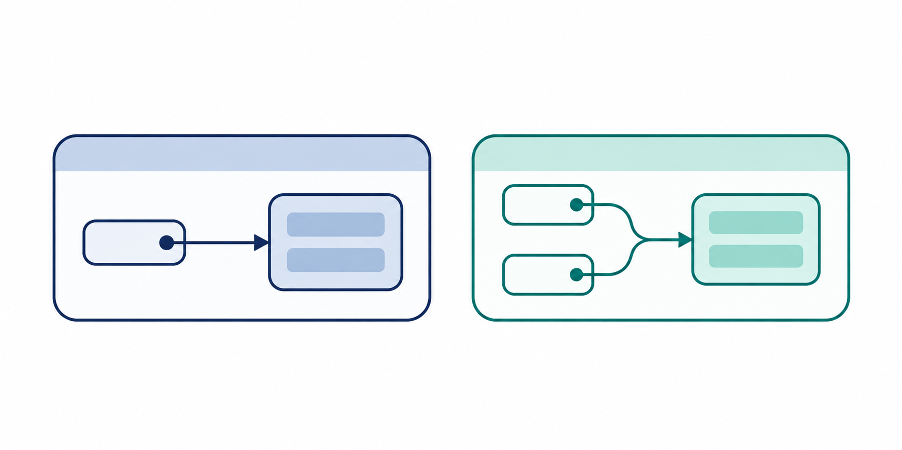

import Callout from '@/components/Callout.astro';

JavaScript에서 객체를 함수에 넘기면 함수 안에서 바꾼 속성이 바깥에서도 보인다. 그런데 매개변수에 새 객체를 할당하면 바깥의 변수는 그대로다. 둘 다 같은 매개변수를 바꾼 것처럼 보이는데, 왜 결과가 다를까?

흔히 “원시값은 값 전달, 객체는 참조 전달”이라고 설명한다. 이 설명만으로는 C++의 참조자와 JavaScript의 객체 전달이 어떻게 다른지 구분하기 어렵다. **함수에 무엇이 복사되는지**, 그리고 그 값으로 **어떤 객체에 접근하는지**를 나눠서 볼 필요가 있다.

C의 값 전달과 C++의 포인터·참조자부터 시작해 JavaScript의 객체 공유까지 정리해보려 한다. 다만 전달 방식을 구분하는 데서 그치면 실제 코드를 작성할 때 무엇을 선택해야 할지는 여전히 모호하다. **복사해서 독립적인 값을 만들 것인지, 같은 데이터를 함께 사용할 것인지, 그리고 그 데이터는 누가 언제까지 관리할 것인지**까지 연결해서 볼 필요가 있다.

## 값 전달과 참조 전달을 굳이 구분하는 이유

함수에 큰 데이터를 넘길 때마다 전체를 복사한다면 어떨까? 호출한 쪽과 함수가 서로 영향을 주지 않는다는 장점이 있지만, 같은 내용을 저장할 공간과 복사하는 시간이 추가로 필요하다. 반대로 같은 데이터를 함께 사용하면 그 복사를 피할 수 있지만, 한쪽의 변경이 다른 쪽에도 보일 수 있다. 데이터를 사용하는 동안 원본이 유효하게 남아 있어야 한다는 조건도 생긴다.

그래서 참조를 강조하는 이유에는 메모리 효율이 있지만, 그것만으로 설명이 끝나지는 않는다. **복사 비용을 줄이는 선택은 변경의 영향 범위와 수명 관리의 책임도 함께 바꾼다.** 읽기만 하는지, 원본을 바꿔도 되는지, 함수가 끝난 뒤에도 데이터를 보관할 것인지에 따라 적합한 방식이 달라진다.

C/C++에서는 이런 의도가 매개변수 타입과 소유권 설계에 직접 드러난다. JavaScript에서는 객체를 공유하는 것이 기본 동작이므로, 독립적인 데이터가 필요할 때 어디까지 복사할지와 공유한 객체를 언제까지 붙잡아둘지를 개발자가 판단해야 한다. 같은 메모리 문제를 다루지만 코드에서 직접 관리하는 지점이 다른 셈이다.

## C에서 함수에 넘기는 것은 값이다

먼저 정수를 함수에 넘기는 경우부터 보자. 함수 안에서 매개변수를 바꿔도 호출한 쪽의 변수는 바뀌지 않는다.

```c
#include <stdio.h>

void update(int value) {
    // value는 호출자 number와 별도의 매개변수 객체다.
    // 이 대입은 함수 내부의 value만 바꾼다.
    value = 20;
}

int main(void) {
    int number = 10;

    // number에 들어 있는 정수 10을 인자로 전달한다.
    update(number);

    // 함수 안의 value가 20이 되어도 number는 그대로다.
    printf("%d\n", number); // 10
    return 0;
}
```

함수의 `value`는 `number`에 들어 있던 `10`으로 초기화된다. 두 변수는 별개이므로 `value = 20`을 실행해도 `number`는 여전히 `10`이다. 이 방식이 **값 전달(Call by Value)**이다.

함수가 끝나면 매개변수 `value`의 수명도 끝난다. 그렇다고 호출한 쪽의 `number`까지 사라지는 것은 아니다. 어떤 값을 전달했는지와 각 변수의 수명은 따로 봐야 한다.

### 포인터를 넘기면 원본을 바꿀 수 있는 이유

정수 대신 그 정수를 가리키는 포인터를 넘기면 결과가 달라진다.

```c
#include <stdio.h>

void update(int* value) {
    // value에는 number를 가리키는 포인터 값이 복사되어 들어 있다.
    // *value는 그 포인터가 가리키는 실제 정수 객체에 접근한다.
    *value = 20;
}

int main(void) {
    int number = 10;

    // &number는 number의 주소를 얻는 표현식이다.
    update(&number);

    // 함수는 포인터를 통해 number 자체를 수정했다.
    printf("%d\n", number); // 20
    return 0;
}
```

여기서도 함수가 받는 것은 **포인터 값의 복사본**이다. 다만 복사된 포인터가 같은 `number`를 가리키고 있으므로, `*value = 20`으로 그 정수를 수정할 수 있다.

즉, 원본을 바꿀 수 있다는 사실만으로 참조 전달이라고 부를 수는 없다. 포인터 자체는 복사되었고, 그 포인터를 따라가서 원본에 접근한 것이다.

C에서 중요한 것은 이 주소로 **어느 범위까지 접근할 수 있고, 언제까지 유효한가**다. 포인터 하나를 넘겨도 대상 데이터 전체를 복사할 필요는 없지만, 포인터만으로는 배열의 길이나 해제 책임을 알 수 없다. 길이를 별도로 전달하고, 대상이 해제된 뒤 접근하지 않도록 호출자와 함수 사이의 약속을 정해야 한다. 주소를 전달하는 편리함만큼 유효성을 관리할 책임도 코드에 남는다.

## C++의 참조자는 원본의 별칭이다

C++에서는 포인터 대신 참조자를 매개변수로 받을 수도 있다. 호출하는 쪽에서 주소를 넘기거나, 함수 안에서 `*`로 역참조할 필요가 없다.

```cpp
#include <iostream>

void update(int& value) {
    // int&는 기존 정수 객체에 바인딩되는 참조자다.
    // 포인터처럼 *value를 쓰지 않고 원본을 수정한다.
    value = 20;
}

int main() {
    int number = 10;

    // number 자체에 value 참조자가 바인딩된다.
    update(number);
    std::cout << number << '\n'; // 20
}
```

이때 `value`는 `number`의 **별칭(alias)**으로 동작한다. `value`에 대입하면 `number` 자체가 바뀐다. 내부 구현에서 주소를 사용할 수는 있지만, 언어 차원에서 참조자를 일반 포인터 변수와 똑같이 취급할 수는 없다. 차이가 드러나는 예가 재대입이다.

```cpp
int a = 10;
int b = 20;
int& ref = a; // ref는 a에 바인딩된다.

ref = 30; // a가 30이 된다.
ref = b;  // ref가 b를 가리키는 것이 아니라 a에 b의 값 20을 대입한다.
```

포인터는 다른 대상을 가리키도록 값을 바꿀 수 있지만, C++ 참조자는 한번 바인딩되면 다른 객체로 재바인딩할 수 없다.

### 큰 데이터를 읽기만 한다면 복사를 피할 수 있다

앞의 `int` 예시에서는 복사할 데이터가 작아서 메모리 효율의 차이가 잘 드러나지 않는다. 이번에는 이미 만들어진 큰 `std::vector`를 함수에 넘긴다고 생각해보자.

```cpp
#include <vector>

// 함수 선언만 비교한다. 두 함수 모두 데이터를 읽는 용도라고 가정한다.
void inspectCopy(std::vector<double> values);
void inspectBorrowed(const std::vector<double>& values);
```

이름이 있는 벡터 변수 `samples`를 `inspectCopy(samples)`로 넘기면, 매개변수 벡터는 요소들을 복사해 별도 저장 공간을 갖는다. `double`이 8바이트인 환경에서 요소가 100만 개라면, 요소 데이터만 약 **8MB(약 7.6MiB)**다. 원본이 살아 있는 동안 복사본도 존재하면 그만큼의 요소 저장 공간이 추가로 필요하고, 요소 수에 비례하는 복사 작업도 발생한다. 벡터 자체와 할당 관리에 드는 공간은 이 계산에서 제외했다.

반면 `inspectBorrowed(samples)`는 기존 벡터에 참조를 바인딩하므로, 인수를 전달하기 위해 100만 개의 요소를 복제하지 않는다. 다만 함수가 모든 요소를 읽는다면 그 순회 비용은 그대로다. 줄어드는 것은 **함수에 넘기기 위해 따로 수행하던 할당과 복사**이지, 데이터 처리 자체의 비용은 아니다.

그렇다고 값 전달이 항상 큰 복사를 만드는 것은 아니다. 이 예시는 기존 벡터를 그대로 넘기는 경우다. 임시 값이나 이동을 활용하는 경우에는 결과가 달라지고, `int`처럼 작은 값은 참조로 접근하는 것보다 복사가 간단하고 빠를 수도 있다. C++ Core Guidelines의 F.16도 읽기 전용 입력에 대해 복사가 저렴한 타입은 값으로, 그 외에는 `const` 참조로 전달하도록 권한다.

여기서 `const std::vector<double>&`는 단순히 성능을 위한 표기가 아니다. **기존 데이터를 빌려 읽되, 이 경로로 요소를 수정하지 않겠다**는 의도도 드러낸다. 참조를 받았다고 소유권을 넘겨받은 것은 아니며, 함수가 그 참조를 나중까지 보관하려면 원본의 수명이 충분한지도 따져야 한다.

### `const`가 붙는 위치에 따라 달라지는 의미

```cpp
int a = 10;
int b = 20;

const int* p1 = &a;
// *p1 = 30;   // 오류: p1을 통해 정수값을 변경할 수 없다.
p1 = &b;       // 가능: p1이라는 포인터는 다른 주소를 가질 수 있다.

int* const p2 = &a;
*p2 = 30;      // 가능: 가리키는 정수 a를 변경할 수 있다.
// p2 = &b;    // 오류: p2 자체는 상수 포인터다.

const int* const p3 = &a;
// *p3 = 40;   // 오류: 정수를 수정할 수 없다.
// p3 = &b;    // 오류: 포인터를 재할당할 수도 없다.
```

`const int*`는 **가리키는 정수를 이 포인터를 통해 수정할 수 없음**을, `int* const`는 **포인터 자체를 재할당할 수 없음**을 의미한다. 둘은 서로 다른 제한이다. `const int*&`라면 `const int*` 타입 포인터 변수에 대한 참조자이므로, 그 참조자를 통해 원래 포인터 변수를 다른 대상으로 재할당할 수 있다.

이 개념은 JavaScript의 `const`와도 다르다. JavaScript의 `const`는 바인딩 재할당을 금지하지만, 바인딩이 가리키는 객체의 속성 변경까지 막지는 않는다.

이 차이는 공유한 데이터를 누가 바꿀 수 있는지를 읽을 때 중요하다. C++의 `const` 참조는 해당 접근 경로의 변경을 제한하지만 다른 경로의 변경까지 막지는 않는다. JavaScript에서는 매개변수를 `const` 참조처럼 선언하는 문법이 없으므로, 함수가 객체를 수정하는지 읽기만 하는지를 구현과 API의 약속에서 확인해야 한다.

## 스택과 힙보다 먼저 봐야 할 것은 수명이다

포인터가 지역 변수라면, 함수가 끝날 때 가리키던 객체도 함께 사라질까? `new`로 만든 객체를 반환하는 경우를 보면 둘의 수명이 다르다는 점을 확인할 수 있다.

```cpp
#include <iostream>
#include <memory>

int* createRaw() {
    // 동적 저장 기간을 가지는 정수 객체를 생성한다.
    int* result = new int(100);

    // 지역 포인터 변수 result의 수명은 함수 종료 시 끝난다.
    // 하지만 new로 생성한 정수 객체는 그 이유로 해제되지 않는다.
    return result;
}

int main() {
    int* number = createRaw();
    std::cout << *number << '\n'; // 100

    // 호출자가 동적 객체의 해제 책임을 진다.
    delete number;

    // 현대 C++에서는 소유권을 명시하는 스마트 포인터를 선호한다.
    auto managed = std::make_unique<int>(200);
    std::cout << *managed << '\n'; // 200
    // managed의 소멸자가 관리 중인 정수를 해제한다.
}
```

흔히 자동 지역 변수는 스택, `new`로 만든 객체는 힙이라고 설명한다. 일반적인 실행 모델로는 유용하지만 **C++ 표준은 모든 지역 변수가 물리적으로 스택에 저장된다고 규정하지 않는다.** 컴파일러는 값을 레지스터에 두거나 계산 자체를 최적화할 수 있다. 정확히는 자동 저장 기간과 동적 저장 기간을 구분하는 편이 좋다.

또한 스택이 항상 빠르고 힙이 항상 느린 것도 아니다. CPU 캐시 관점에서는 **연속적인 데이터 배치와 접근 패턴**이 중요하다. 힙에 할당된 `std::vector`의 요소도 연속적으로 저장되며, 반대로 떨어진 객체를 포인터로 반복 탐색하면 캐시 미스가 증가할 수 있다.

<Callout theme="note" title="스마트 포인터가 관리하는 것은 소유권이다">
  `std::unique_ptr`는 객체의 고유 소유권을 표현한다. 복사는 할 수 없지만
  이동으로 소유권을 넘길 수 있다. 위 예시에서는 `managed`가 범위를 벗어나 소멸할
  때 관리하던 정수도 해제된다. 자원의 정리를 객체의 수명에 연결하는 RAII
  방식이다.
</Callout>

이 예시에서 C++이 코드로 드러내는 것은 **누가 자원을 소유하고, 그 소유자의 수명이 끝날 때 무엇을 정리하는가**다. C에서는 동적 메모리의 해제 책임을 직접 정하는 경우가 많고, C++에서는 RAII와 스마트 포인터로 그 책임을 객체의 수명에 연결할 수 있다. 두 경우 모두 포인터나 참조로 접근할 수 있다는 사실과, 그 자원을 해제할 책임이 있다는 사실은 별개다.

따라서 복사를 피하려고 참조를 선택했더라도 소유자가 먼저 사라지면 안전하게 사용할 수 없다. 복사 비용을 줄였는지만큼 **빌린 데이터를 사용하는 동안 누가 원본을 유지하는지**가 중요하다.

## JavaScript에서 객체를 넘기면 무엇이 복사될까?

이제 처음의 JavaScript 예시로 돌아가 보자. 함수 안에서 객체의 속성을 바꾸면 바깥에서도 변경된 값을 볼 수 있다.

```javascript
function update(point) {
  // point가 식별하는 객체의 속성을 수정한다.
  // 함수 바깥의 original도 같은 객체를 식별한다.
  point.x = 100;
}

const original = { x: 10 };
update(original);

console.log(original.x); // 100
```

함수에 객체 전체가 새로 복사된 것은 아니다. `point`와 `original`은 서로 다른 바인딩이지만 **같은 객체에 접근**한다. 그래서 `point.x`를 바꾸면 `original.x`에서도 변경된 값을 읽게 된다. 이렇게 객체를 공유하는 성질을 **Call by Sharing**이라고 부르기도 한다.

그렇다면 매개변수 자체를 재할당할 때는 왜 결과가 다를까?

```javascript
function update(point) {
  // 새로운 객체를 만들고 지역 매개변수 point에만 다시 할당한다.
  // original이라는 외부 바인딩은 변경되지 않는다.
  point = { x: 100 };
}

const original = { x: 10 };
update(original);

console.log(original.x); // 10
```

`point.x = 100`은 **공유 중인 객체를 수정**하지만, `point = { x: 100 }`은 **매개변수 바인딩을 다른 객체로 변경**한다. JavaScript는 C++의 참조 매개변수처럼 호출자의 변수 자체를 재바인딩하지 않는다.

이 구분은 용어를 엄밀하게 쓰기 위한 것만은 아니다. C++의 `T&`를 기대하면 호출자의 변수까지 바뀔 것으로 오해할 수 있고, 값 전달이라는 말만 보면 객체 전체가 복사되어 서로 독립적이라고 오해할 수 있다. MDN의 함수 설명도 매개변수 재할당과 객체 속성 변경의 결과를 나눠 설명한다.



_C++의 포인터·참조자와 JavaScript의 객체 공유를 단순화한 그림이다. 주소는 예시이며, JavaScript 쪽 화살표가 실제 엔진의 포인터 배치를 뜻하는 것은 아니다._

### JavaScript에서는 복사할 때 오히려 선택이 필요하다

큰 배열을 함수에 넘겨도 인수 전달 자체가 모든 요소를 새 배열로 복제하지는 않는다. C++에서 읽기 전용 참조로 큰 벡터를 빌려 쓰는 경우처럼, 원본 데이터 전체의 복사를 피한다는 점에서는 비슷한 이점이 있다. 다만 JavaScript가 C++의 참조 타입을 제공한다는 의미는 아니다.

독립적으로 수정할 필요가 있다면 복사 범위를 직접 선택해야 한다. 전개 구문을 사용해도 중첩된 객체까지 모두 독립적으로 바뀌지는 않는다.

```javascript
const original = { position: { x: 10 } };
const copy = { ...original };

console.log(copy === original); // false: 바깥 객체는 새로 만들었다.
console.log(copy.position === original.position); // true: 중첩 객체는 공유한다.

copy.position.x = 20;
console.log(original.position.x); // 20
```

바깥 객체의 속성을 새 객체로 복사했지만, `position`이 식별하는 객체는 그대로 공유한다. 이런 **얕은 복사**로 충분한 경우도 있고, 중첩 데이터까지 독립적으로 바꿔야 하는 경우도 있다. 더 깊게 복사하면 그 범위만큼 새 객체와 복사 작업이 필요하므로, 무조건 모두 복제하기보다 어느 부분을 독립시켜야 하는지 먼저 정해야 한다.

공유가 항상 메모리 사용량을 줄여주는 것도 아니다. 당장의 복제는 피하더라도, 오래 살아 있는 캐시나 이벤트 콜백이 큰 객체를 계속 참조하면 그 객체도 계속 남을 수 있다. JavaScript에서는 개발자가 객체를 직접 해제하기보다 **필요 없는 객체로 이어지는 참조를 언제 끊을지** 관리해야 한다. GC는 개발자가 사용을 끝냈는지가 아니라 루트에서 도달 가능한지를 기준으로 회수 여부를 판단하기 때문이다.

### `const`가 막는 것도 바인딩의 재할당이다

JavaScript의 `const`도 같은 구분으로 이해할 수 있다. 바꿀 수 없는 것은 바인딩이지, 그 바인딩으로 접근하는 객체의 모든 속성이 아니다.

```javascript
const point = { x: 10 };

// const는 point라는 바인딩의 재할당을 막는다.
// 객체 내부 속성까지 동결하는 것은 아니다.
point.x = 20; // 가능

// point = { x: 30 }; // TypeError: const 바인딩 재할당

// 객체의 속성 변경을 제한하려면 별도의 메커니즘이 필요하다.
Object.freeze(point); // 얕은 동결; 중첩 객체까지 자동으로 동결하지 않는다.
```

## 같은 객체라는 것이 같은 주소라는 뜻일까?

객체를 공유한다는 것은 비교 연산에서도 드러난다. 속성값이 같은 객체 두 개를 만들어도, 둘이 같은 객체가 되는 것은 아니다.

```javascript
const a = { value: 10 };
const b = a;
const c = { value: 10 };

// a와 b는 같은 객체를 식별한다.
console.log(a === b); // true

// c는 속성값만 같은 별개의 객체다.
console.log(a === c); // false
```

JavaScript 객체의 `===`는 속성값을 하나씩 비교하지 않는다. **같은 객체인지**, 즉 동일성을 비교한다. 이후 V8의 GC가 객체를 다른 메모리 위치로 옮기더라도 `a === b`는 여전히 `true`여야 한다. 엔진은 이동한 객체에 대한 내부 참조를 적절히 갱신한다.

따라서 **객체의 정체성(Object Identity)** 과 **객체가 배치된 물리적 주소**를 동일한 개념으로 보아서는 안 된다. ECMAScript 명세는 객체의 동작을 정의하지만, 이를 어떤 비트 표현이나 주소에 저장할지 강제하지 않는다.

C/C++에서 다룬 주소와 수명에 관한 질문이 JavaScript에서는 객체의 동일성과 도달 가능성에 관한 질문으로 옮겨온다. 일반적인 JavaScript 코드에서는 이동한 주소를 직접 고칠 필요는 없지만, 서로 다른 코드가 같은 객체를 공유하는지와 그 객체를 계속 유지하는 참조가 무엇인지는 여전히 알아야 한다.

## V8은 값을 어떻게 표현할까?

언어에서 보장하는 동작과 엔진의 구현을 나눴다면, 이제 V8이 실제로 값을 다루는 방식도 살펴볼 수 있다. JavaScript에서는 하나의 바인딩에 여러 종류의 값을 차례로 할당할 수 있다.

```javascript
let value = 10;
value = 'hello';
value = { x: 20 };
```

V8은 이런 코드를 실행하면서 값의 종류와 용도에 따라 여러 내부 표현을 사용한다.

- **Tagged Value**: 값과 해당 값의 분류를 구별할 수 있도록 태그를 활용하는 내부 표현
- **Smi(Small Integer)**: 작은 정수를 값 표현 내부에 직접 담을 수 있는 방식
- **HeapNumber**: 특정 숫자를 힙 객체로 표현할 때 사용하는 내부 구조
- **HiddenClass(Map)**: 객체가 가진 속성의 형태와 배치 정보를 표현하는 V8 내부 메타데이터

이런 내부 표현을 보면 “JavaScript 원시값은 모두 스택, 객체는 모두 힙”이라는 설명만으로는 실제 배치를 설명하기 어렵다. 같은 숫자도 엔진이 어떤 표현을 선택하는지에 따라 다르게 다뤄질 수 있다.

HiddenClass도 객체 자체와는 구분해야 한다. 속성 구조가 같아서 메타데이터를 공유할 수 있어도, 두 객체의 동일성까지 같아지는 것은 아니다.

```javascript
const first = { x: 10, y: 20 };
const second = { x: 30, y: 40 };

// 속성을 같은 순서로 추가한 객체들은
// V8에서 속성 형태 관련 메타데이터를 공유할 수 있다.
// 이는 first와 second가 같은 객체라는 의미는 아니다.
console.log(first === second); // false
```

V8은 HiddenClass와 in-object properties 등의 기법을 활용하여 동적인 속성 접근을 최적화한다. GC에 의한 단편화 감소와 **객체 속성 접근 최적화는 서로 다른 문제**다.

이 때문에 전달 방식만 보고 실제 성능을 몇 배 개선한다고 말하기는 어렵다. 복사를 피했는지에 더해, 할당한 객체의 수와 크기, 접근 패턴, 유지 기간, 엔진 최적화를 함께 봐야 한다. 앞의 8MB 계산은 특정 조건에서 생기는 추가 요소 저장 공간의 예시이며 실행 시간을 측정한 결과는 아니다.

## 다시 값 전달로 돌아오면

C에서 포인터를 전달해도 인수 전달 자체는 값 전달이며, C++의 참조자는 원본 객체의 별칭으로 동작한다. JavaScript 역시 인수를 값으로 전달하지만, 객체를 식별하는 값이 복사되어 **동일한 객체를 공유**할 수 있다.

이 차이를 실제 코드에 적용할 때는 복사되는 데이터의 크기, 원본을 수정할 권한, 사용이 끝날 때까지 데이터를 유지할 책임을 함께 보면 좋다. C/C++에서는 유효한 접근 범위와 수명·소유권을 코드로 설계하는 일이 중요하고, JavaScript에서는 객체 공유의 영향 범위와 도달 가능한 참조를 관리하는 일이 중요하다. GC가 해제를 맡아도 필요 없는 데이터를 계속 붙잡는 책임까지 사라지지는 않는다.

이 차이를 이해하고 나면 더 큰 질문이 남는다. 여러 바인딩과 객체가 서로 연결되어 있을 때, V8은 **무엇을 기준으로 객체의 수명을 판단하고**, 필요에 따라 메모리를 어떻게 이동하고 회수할까?

이어지는 V8 GC에서 Chromium Oilpan까지에서는 이 질문을 이어서 V8의 GC와 Chromium의 Oilpan이 객체를 관리하는 방식을 살펴본다.

## References

- [이어지는 글 — V8 GC에서 Chromium Oilpan까지](/articles/cpp/v8-gc-memory-leaks/)
- [C++ Core Guidelines — F.16: 입력 매개변수의 값 전달과 const 참조](https://isocpp.github.io/CppCoreGuidelines/CppCoreGuidelines#Rf-in)
- [MDN — Functions](https://developer.mozilla.org/en-US/docs/Web/JavaScript/Guide/Functions)
- [MDN — Memory management](https://developer.mozilla.org/en-US/docs/Web/JavaScript/Guide/Memory_management)
- [V8 — Pointer Compression in V8](https://v8.dev/blog/pointer-compression)
- [V8 — Fast properties in V8](https://v8.dev/blog/fast-properties)
- [cppreference — Storage duration](https://en.cppreference.com/w/cpp/language/storage_duration)
- [cppreference — std::unique_ptr](https://en.cppreference.com/w/cpp/memory/unique_ptr)
