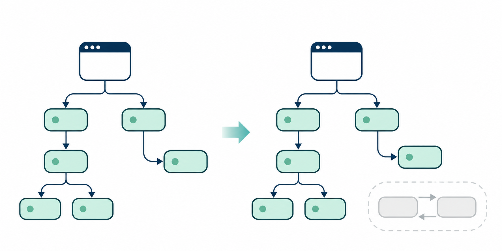
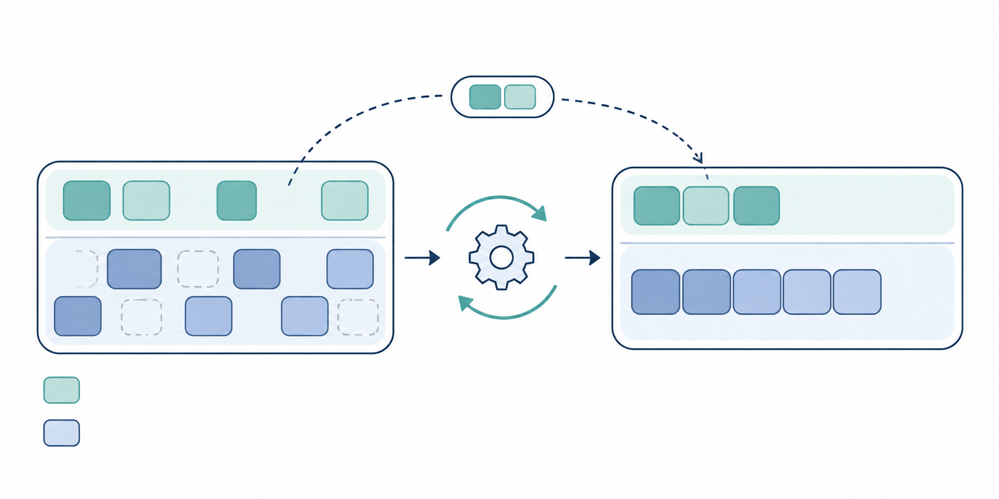
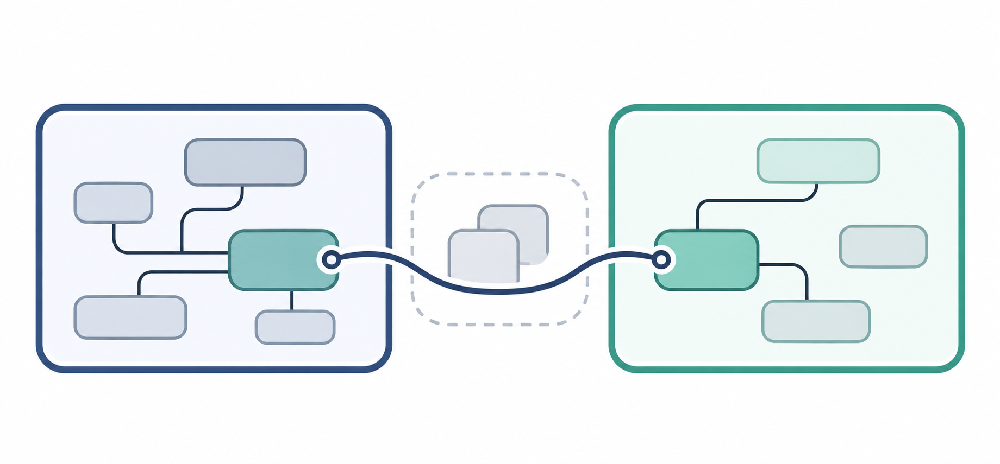
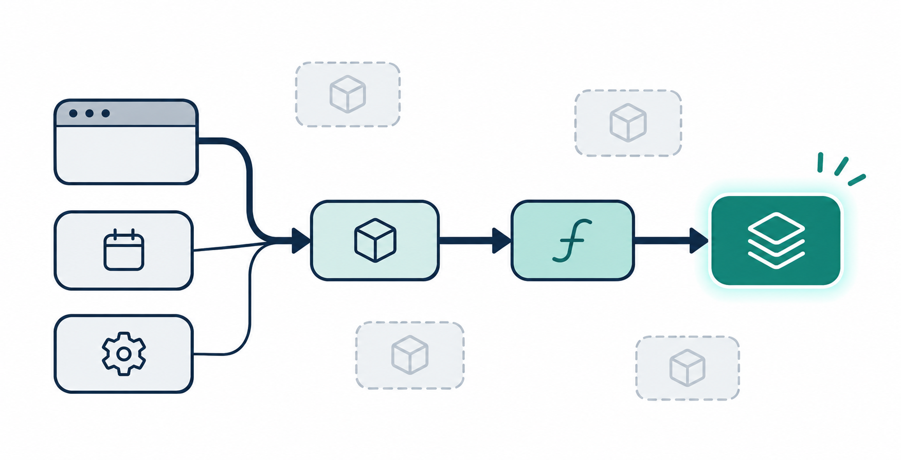

import Callout from '@/components/Callout.astro';

앞선 글에서는 값 전달과 참조를 복사 비용, 변경 권한, 수명 관리의 관점에서 비교했다. 큰 데이터를 함께 사용하면 전체를 복제하는 비용을 피할 수 있지만, 사용하는 동안 원본을 유지해야 하고 한쪽의 변경이 다른 쪽에도 보일 수 있다는 내용이었다.

그렇다면 그 객체를 더 이상 사용하지 않을 때는 어떻게 될까? JavaScript에서는 C++의 `delete`처럼 직접 메모리를 해제하지 않는다. 엔진이 알아서 정리해준다고 생각하기 쉽지만, 사용이 끝난 화면이나 큰 배열이 메모리에 계속 남아 있는 경우도 있다.

앞선 글이 **데이터를 복사할 것인지, 함께 사용할 것인지**에 대한 이야기였다면, 이번에는 **함께 사용하는 데이터를 언제까지 유지할 것인지**에 대한 이야기다. V8이 객체의 생존 여부를 확인하는 방법부터 Blink의 C++ 객체 관리까지 살펴보고, 마지막에는 DevTools로 불필요한 참조를 찾는 과정으로 연결해보려 한다.

## 메모리를 쓰는 일과 정리하는 일

객체를 만드는 것만으로 메모리 관리가 끝나지는 않는다. 값을 저장할 공간을 얻고, 그 값을 사용한 뒤, 필요 없어진 공간을 다시 쓸 수 있게 돌려줘야 한다.

MDN은 메모리 생명주기를 **할당(Allocate) → 사용(Use) → 회수(Release)**로 나눈다. C에서는 동적으로 할당한 공간의 해제 책임을 직접 정하고, C++에서는 RAII로 자원의 정리를 소유자의 수명에 연결할 수 있다. JavaScript에서는 엔진의 **가비지 컬렉터(Garbage Collector, GC)**가 더 이상 도달할 수 없는 객체의 메모리를 회수한다.

여기서 달라지는 것은 책임이 사라지는지가 아니라 **어떤 책임을 코드에서 직접 다루는가**다. C/C++에서는 원본이 해제된 뒤 포인터나 참조로 접근하지 않도록 수명을 설계해야 한다. JavaScript에서는 참조하는 동안 객체를 유지하는 일을 엔진에 맡기는 대신, 사용이 끝난 객체로 이어지는 참조가 불필요하게 남지 않도록 해야 한다.

문제는 GC가 개발자의 의도까지 알 수는 없다는 점이다. 화면에서 더 이상 쓰지 않는 데이터라도 코드 어딘가에서 접근할 수 있다면 함부로 없앨 수 없다. 그래서 판단 기준으로 사용하는 것이 **도달 가능성(Reachability)**이다.

<Callout theme="note" title="RAII와 도달 가능성은 정리 기준이 다르다">
  RAII는 자원을 소유한 객체가 소멸할 때 자원도 정리하도록 연결하는 C++의
  방식이다. 도달 가능성은 실행 중인 코드가 참조를 따라 객체에 접근할 수 있는지를
  뜻한다. JavaScript에서 참조를 끊는 것은 회수 가능한 상태를 만드는 것이며, 그
  줄에서 즉시 메모리를 돌려받는다는 뜻은 아니다.
</Callout>

## 서로 참조하는 객체는 정리되지 않을까?

객체 두 개가 서로를 참조하면 어느 쪽도 정리할 수 없을 것처럼 보인다. 아래처럼 함수 안에서 순환 구조를 만드는 경우를 보자.

```javascript
function createCycle() {
  const first = {};
  const second = {};

  // 두 객체가 서로를 참조하도록 만든다.
  first.next = second;
  second.next = first;

  // 반환하지 않았으므로, 이 코드만으로는 외부에 참조가 남지 않는다.
  // 함수 종료 후 다른 루트에서 연결되지 않으면 두 객체 모두 수거 가능하다.
}

createCycle();
```

**참조 카운팅**은 객체를 가리키는 참조의 수를 세고, 그 수가 0이 되면 정리하는 방식이다. 위 예시처럼 서로를 가리키면 외부에서 접근할 수 없어도 각 객체의 참조 수는 0이 되지 않는다.

V8의 추적 GC는 이와 달리 실행 환경의 출발점에서 참조를 따라가며 살아 있는 객체를 찾는다. 그래서 **순환 참조 자체가 누수의 조건은 아니다.** 중요한 것은 그 순환 구조에 외부에서 도달할 수 있는지다.



_GC Roots에서 A, B, C에는 도달할 수 있다. D와 E는 서로를 참조하지만 루트에서는 접근할 수 없는 상태다. 실제 구현을 단순화한 그림이다._

<Callout theme="note" title="GC Roots와 객체 그래프란?">
  GC Roots는 객체의 생존 여부를 확인할 때 출발하는 참조들의 집합이다. 실행 중인
  함수의 살아 있는 참조나 전역 객체, 엔진이 유지하는 참조 등이 여기에 포함된다.
  객체를 점으로, 객체 사이의 참조를 선으로 그린 것이 객체 그래프다. 루트에서
  선을 따라 도달할 수 있는 객체는 유지한다.
</Callout>

이때 **도달 가능하다**는 것은 **제품 기능상 여전히 필요하다**와 같은 뜻이 아니다. 프로그램이 불필요하게 참조를 유지하고 있다면 GC도 그 객체를 회수할 수 없다.

예를 들어 같은 8MB짜리 데이터를 여러 함수가 잠깐 공유하면 중복 복사를 피할 수 있지만, 더 이상 쓰지 않는 캐시가 그 데이터를 계속 보관한다면 그 공간은 재사용할 수 없다. 전달 시점의 복사량뿐 아니라 사용이 끝난 뒤 얼마나 오래 남는지도 메모리 효율에 영향을 준다.

## 살아 있는 객체를 찾고 공간을 회수하기

Orinoco는 V8의 GC를 병렬·동시 처리 등으로 개선해 온 프로젝트 이름이다. 해당 설계 글은 GC의 핵심 작업을 살아 있는 객체 찾기, 죽은 객체의 공간 재사용, 필요한 경우의 압축으로 나눈다. 이 과정을 보면 자동 회수에도 계산 비용이 든다는 점을 알 수 있다.

### Marking: 살아 있는 객체 찾기

GC Roots에서 출발해 도달 가능한 객체를 표시한다. 루트에서 발견되지 않는 객체는 수거 대상이 될 수 있다.

### Sweeping: 사용하지 않는 공간 회수

표시되지 않은 객체가 차지하던 공간을 다시 할당에 사용할 수 있도록 회수한다. 이 단계가 모든 객체를 이동시키는 것은 아니다.

여기서 회수는 우선 엔진이 그 공간을 다시 쓸 수 있게 한다는 뜻이다. 운영체제에 즉시 돌려줘서 프로세스 메모리 수치가 같은 크기만큼 줄어든다는 뜻은 아니다.

### Compaction: 단편화 줄이기

오래 실행되는 프로그램에서는 할당과 회수가 반복되며 빈 공간이 여기저기 흩어질 수 있다. 이렇게 공간이 잘게 나뉜 상태를 **단편화**라고 한다. Compaction은 필요한 경우 살아 있는 객체를 이동시켜 흩어진 빈 공간을 모으는 작업이다.



_사용 중인 객체를 모아 빈 공간을 줄이는 과정을 단순화한 그림이다. 실제 V8이 매번 모든 객체를 옮기는 것은 아니며, 이동할 때는 관련 내부 참조도 갱신해야 한다._

JavaScript에서 `a === b` 같은 객체 동일성은 이동 전후에도 유지되어야 한다. 참조 갱신은 GC의 구현 책임이다.

살아 있는 객체를 찾으려면 참조를 따라가야 하고, 객체를 옮기려면 데이터와 내부 참조도 갱신해야 한다. 압축하면 공간을 활용하기 좋아지지만 이동 비용도 들기 때문에, 매번 모든 객체를 옮기는 것이 유리하지는 않다. **GC는 메모리를 재사용하기 위해 실행 시간도 사용하는 장치**다.

가까이 있는 데이터를 연이어 읽기 좋은 성질을 캐시 지역성이라고 한다. 압축이 이에 도움을 줄 수는 있지만 GC의 목적 전체를 설명하지는 못한다. 앞선 글의 HiddenClass는 객체의 속성 구조를 기록하는 정보이고, in-object properties는 일부 속성값을 객체 내부에 배치하는 방식이다. 이들은 속성 접근을 위한 객체 표현 최적화이며, 객체를 언제 회수할지 결정하는 문제와는 구분해야 한다.

## 객체를 세대로 나누는 이유

대부분의 객체가 생성 후 비교적 빨리 필요 없어진다는 경험적 관찰을 **세대 가설(Generational Hypothesis)**이라고 부른다. 잠깐 계산하고 버리는 객체와 오래 유지하는 객체를 매번 똑같이 검사하기보다는, 살아남은 기간에 따라 나누어 관리하자는 생각이다.

```javascript
function calculate() {
  // 의미상 임시 객체를 만들어 사용하는 예시다.
  // 실제 힙 할당은 V8 최적화에 의해 제거될 수도 있다.
  const point = { x: 10, y: 20 };

  return point.x + point.y;
}

console.log(calculate()); // 30
```

**Young Generation**은 새로 할당된 객체들을 관리하는 영역이고, **Old Generation**은 여러 수거 과정을 거치며 살아남은 객체들을 관리하는 영역이다. 젊은 영역은 비교적 자주 검사하고, 생존한 객체는 조건에 따라 오래된 영역으로 옮긴다. 이 이동을 승격이라고 부른다. 덕분에 매번 전체 힙을 검사하는 비용을 줄일 수 있다.

그렇다고 오래 살아남는 객체가 곧 누수라는 뜻은 아니다. 필요한 캐시는 오래 유지하는 편이 맞을 수 있다. 반대로 짧게 쓰는 객체도 지나치게 많이 만들면 할당과 회수 작업이 잦아질 수 있다. **오래 남은 불필요한 객체를 줄이는 일과, 짧은 수명의 객체를 과도하게 만드는 일을 줄이는 것은 서로 다른 개선**이다.

<Callout theme="note" title="세대 구분의 원리와 구현 세부사항은 구분해야 한다">
  V8의 GC 구현은 계속 바뀐다. 여기서 참고한 2019년 Orinoco 글의 세부 알고리즘을
  모든 버전에서 유지되는 구조로 받아들이기보다는, 객체를 세대로 나누는 이유와
  설계 원리를 이해하는 데 초점을 맞추면 좋다.
</Callout>

## GC가 길어지면 화면에도 영향을 준다

마킹과 객체 이동이 메인 스레드를 오래 점유하면 입력 처리와 화면 갱신이 지연될 수 있다. Orinoco가 개선한 것은 단순히 메모리 회수량만이 아니라 **GC로 인한 실행 중단과 지연**이다.

| 접근        | 의미                                       |
| ----------- | ------------------------------------------ |
| Parallel    | 여러 작업자가 하나의 GC 작업을 나누어 처리 |
| Concurrent  | JavaScript 실행과 GC 작업 일부를 겹쳐 수행 |
| Incremental | 긴 작업을 짧은 단계로 나누어 수행          |

JavaScript와 마킹을 함께 진행하면 그 사이에 참조가 바뀔 수 있다. GC가 이미 살펴본 객체에 새로운 참조가 생길 수도 있으므로, 처음 조사한 결과만 믿고 회수해서는 안 된다. V8은 **Write Barrier** 같은 메커니즘으로 이런 변경을 추적한다.

<Callout theme="note" title="Write Barrier는 참조 변경을 알리는 장치다">
  Write Barrier는 객체에 참조를 저장할 때 엔진이 수행하는 추가 처리다. 마킹 중에
  생긴 연결이나 오래된 세대에서 젊은 세대로 향하는 연결처럼, GC가 알아야 할
  변경을 기록하는 데 쓰인다. 개발자가 객체를 수정할 때마다 직접 호출하는 함수는
  아니다.
</Callout>

작업을 나누거나 다른 스레드에서 처리한다고 해서 모든 중단이 없어지는 것은 아니다. 여러 작업자를 쓰면 CPU 자원도 사용하고, 참조 변경을 추적하는 처리도 필요하다. 한 번의 중단을 짧게 만드는 것과 전체 작업량을 줄이는 것은 같은 목표가 아니므로, 메모리 수치와 함께 입력 지연이나 프레임 지연도 봐야 한다.

## DOM 뒤에 있는 C++ 객체는 누가 정리할까?

여기까지는 JavaScript 객체를 중심으로 봤다. 그런데 브라우저에서 자주 다루는 DOM은 JavaScript만으로 구현되어 있지 않다. JavaScript 실행은 V8이 담당하고, DOM의 많은 동작은 C++ 기반 Blink가 구현한다.

```javascript
// document.createElement는 JS에서 호출하지만,
// 실제 DOM 구현은 Blink의 네이티브 객체와 연결된다.
const element = document.createElement('div');

// DOM 노드를 문서 트리에 연결한다.
document.body.appendChild(element);

// JS 바인딩이 사라져도 문서 트리 등 다른 소유·참조 관계가 남아 있을 수 있다.
```

여기서 **래퍼(wrapper)**는 JavaScript 코드가 C++의 DOM 객체를 다룰 수 있게 연결해주는 JavaScript 쪽 객체를 뜻한다. 같은 DOM 요소를 두 언어의 영역에서 다루므로, 어느 쪽에서 여전히 접근 가능한지 함께 고려해야 한다. Chromium의 모든 C++ 메모리가 V8 힙에 들어간다는 뜻은 아니다.

### Oilpan은 C++ 객체 사이의 참조도 추적한다

**Oilpan**은 Blink의 DOM 주변 C++ 객체처럼 서로 연결된 관리 대상의 메모리를 추적하는 GC다. V8의 C++ GC 설계 글은 JavaScript와 C++ 사이의 연결도 따라가는 **영역 간 추적(Cross-component Tracing)**을 설명한다. 예를 들어 문서에서 제거된 요소라도 JavaScript가 여전히 보관하고 있다면 그 사용 가능성을 함께 고려해야 한다.

이 지점에서는 C++도 도달 가능성을 기준으로 객체를 관리한다. 언어가 C++이라는 이유만으로 모든 객체를 개발자가 직접 해제한다고 볼 수는 없다. 관리 대상의 연결 관계와 수명 특성에 맞춰 소유권 기반 관리와 추적 GC를 선택하는 것이다.

```cpp
// Oilpan/cppgc의 핵심 패턴을 단순화한 예시.
// 실제 컴파일에는 해당 환경의 헤더, 네임스페이스, 할당 API가 필요하다.
class LinkedNode final : public GarbageCollected<LinkedNode> {
 public:
  explicit LinkedNode(LinkedNode* next) : next_(next) {}

  void Trace(Visitor* visitor) const {
    // GC가 다른 관리 객체로 이어지는 참조를 발견하도록 알린다.
    visitor->Trace(next_);
  }

 private:
  // 일반 raw pointer 대신 GC가 추적할 수 있는 멤버를 사용한다.
  Member<LinkedNode> next_;
};
```

`GarbageCollected<T>`는 이 클래스의 객체가 GC 관리 대상임을 나타낸다. `Member<T>`는 다른 관리 객체로 이어지는 멤버 참조이며, `Trace()`에서 그 연결을 수거기에 알려준다. `Visitor`는 이런 연결을 방문하고 처리하는 GC 쪽 도구다.

즉, 여기서 개발자가 명시하는 것은 이 객체가 사라질 때 다른 객체도 해제하라는 명령이 아니라 **이 객체에서 어떤 관리 객체로 이어지는지**다. 같은 스마트 포인터처럼 보여도 고유 소유권을 표현하는 `std::unique_ptr`와는 역할이 다르다. GC가 관계를 추적할 수 있도록 정확하게 선언하는 책임은 C++ 코드에 남는다.



_JavaScript 객체와 Blink의 C++ 객체 사이의 참조를 함께 추적하는 개념도다. 생존 관계를 함께 확인한다는 뜻이지, 두 영역이 하나의 물리적 힙을 공유한다는 뜻은 아니다._

V8과 Oilpan이 협력하면 JavaScript와 C++ 영역을 잇는 참조를 고려해 객체의 생존 여부를 판단할 수 있다. 단, **Chromium의 모든 C++ 객체가 Oilpan으로 관리되는 것은 아니다.** 다른 할당자와 명시적 소유권 관리도 함께 존재한다.

## GC가 있어도 필요 없는 객체는 남을 수 있다

도달 가능성이 기준이라는 점을 다시 떠올려보자. 더 이상 쓰지 않는 데이터를 전역 배열에 계속 넣어두면, GC 입장에서는 여전히 접근 가능한 객체다.

```javascript
const retained = [];

function allocate() {
  // 호출할 때마다 새로운 배열 하나를 생성한다.
  const data = new Array(100_000).fill(0);

  // 전역 배열이 data를 계속 참조하도록 만든다.
  // 필요 없는 데이터라도 도달 가능하므로 GC가 회수할 수 없다.
  retained.push(data);
}

// 실험용 코드: 장시간 실행하면 메모리 사용량이 계속 증가할 수 있다.
const timerId = setInterval(allocate, 1000);

// 실험 종료 시 타이머와 보관된 참조를 정리한다.
// clearInterval(timerId);
// retained.length = 0;
```

타이머가 실행될 때마다 `retained`에 배열이 하나씩 추가된다. 나중에 쓸 계획이 없어도 배열에서 접근할 수 있으므로 GC는 회수할 수 없다. 이 경우에는 **데이터를 계속 보관하는 참조를 정리해야 한다.**

이 실험에서는 타이머를 멈추는 것과 보관한 데이터를 비우는 것도 구분해야 한다. `clearInterval(timerId)`는 앞으로 배열이 더 만들어지는 것을 막고, `retained.length = 0`은 이미 보관한 배열들로 향하는 참조를 제거한다. 다른 참조가 없다면 그 배열들은 회수 가능한 상태가 된다. 증가를 멈추는 일과 기존 데이터를 놓아주는 일은 별개다.

### 화면을 떠나도 이벤트 리스너는 남을 수 있다

비슷한 일이 이벤트 리스너에서도 생긴다. `window`에 등록한 콜백이 큰 배열을 참조하고 있다면, 등록한 함수의 실행이 끝나도 그 배열이 계속 유지될 수 있다.

함수가 만들어진 바깥의 변수에 나중에도 접근할 수 있는 성질을 **클로저(Closure)**라고 한다. 아래에서는 이벤트 콜백이 `data`에 접근해야 하므로 그 연결이 남는다.

```javascript
function mount() {
  // 큰 배열을 생성한다. 실제 필요한 크기는 실험에 맞춰 조정한다.
  const data = new Array(100_000).fill(0);

  function handleClick() {
    // 이 콜백은 data를 참조하는 클로저를 형성한다.
    console.log(data.length);
  }

  // window는 컴포넌트 함수가 끝난 뒤에도 계속 살아 있다.
  window.addEventListener('click', handleClick);

  // 호출자가 사용 종료 시 명시적으로 실행할 정리 함수를 반환한다.
  return () => window.removeEventListener('click', handleClick);
}

const cleanup = mount();

// 더 이상 이벤트가 필요하지 않은 시점에 호출한다.
cleanup();
```



_이벤트 리스너와 클로저를 거쳐 배열에 도달하는 경로다. 리스너를 제거하더라도 다른 참조가 남아 있다면 배열은 계속 유지될 수 있다._

React에서도 `useEffect` 안에서 등록한 이벤트 리스너나 타이머, 구독은 상황에 따라 cleanup이 필요하다. 하지만 이벤트 리스너가 있다는 사실만으로 모두 메모리 누수라고 판단해서는 안 된다. 실제로 **더는 필요하지 않은 객체가 유지되는지** 확인해야 한다.

## DevTools에서는 무엇을 확인해야 할까?

메모리 사용량이 한 번 늘었다는 사실만으로 누수라고 판단하기는 어렵다. 같은 화면에 들어갔다 나오는 동작을 반복했을 때 어떤 객체가 계속 남는지, 그리고 **무엇이 그 객체를 붙잡고 있는지**를 확인하는 편이 도움이 된다. Chrome DevTools에서는 Heap Snapshot과 Retainers로 이 경로를 살펴볼 수 있다.

<Callout theme="note" title="Snapshot과 Retainers는 무엇을 보여줄까?">
  Heap Snapshot은 특정 시점의 힙 객체와 참조 관계를 기록한 자료다. 힙은 엔진이
  객체 등을 할당하고 관리하는 메모리 영역을 뜻한다. Retainers는 선택한 객체를
  붙잡고 있는 참조를 보여준다. 객체 자신이 차지하는 크기인 Shallow Size와, 그
  객체가 사라질 때 함께 회수 가능해지는 객체들까지 포함한 Retained Size도
  구분해야 한다. 작은 콜백 하나가 큰 배열을 유지한다면 콜백 자체의 크기만으로
  영향을 판단할 수 없다.
</Callout>

1. **기준 기록**: 화면이 안정된 상태에서 Memory 패널의 첫 Heap Snapshot을 만든다.
2. **반복**: 의심되는 화면 진입·이탈이나 버튼 클릭을 여러 번 반복한다.
3. **비교**: 두 번째 Snapshot을 찍고 Comparison 보기에서 증가한 객체를 찾는다. Heap Snapshot을 수집할 때는 GC가 먼저 실행된다.
4. **참조 추적**: 증가한 객체의 Retainers를 열어 Window, Listener, Closure, Cache 등 유지 경로를 확인한다.
5. **수정 후 재검증**: 관련 참조를 정리하고 같은 동작·조건에서 다시 측정한다. 반복 횟수를 늘렸을 때 불필요한 객체 수와 유지되는 크기가 계속 증가하는지 비교한다.

**Detached DOM**은 문서 트리에서 분리된 DOM 노드다. 화면에서 제거했어도 JavaScript가 계속 참조하면 남을 수 있다. 나중에 다시 붙일 의도로 보관하는 경우도 있으므로, 분리되어 있다는 사실만으로 누수라고 판단해서는 안 된다.

한 번 메모리가 증가했다고 누수로 단정하기도 어렵다. GC 타이밍, 캐시, 엔진의 메모리 확보, 실행 중 코드를 컴파일하는 JIT 최적화 등으로 정상적인 변화도 생긴다. 같은 동작을 반복한 뒤에도 필요 없는 객체가 계속 남는지, 그 객체로 이어지는 경로가 무엇인지 확인해야 한다.

<Callout
  theme="note"
  title="Heap Snapshot이 프로세스 전체 메모리를 보여주는 것은 아니다"
>
  Heap Snapshot은 주로 JavaScript 힙과 연결된 참조를 조사하는 도구다. 프로세스의
  모든 네이티브 메모리나 GPU 메모리가 같은 방식으로 표시되는 것은 아니므로,
  스냅샷에서 보이는 크기를 브라우저 전체 사용량과 동일하게 해석하면 안 된다.
</Callout>

## 결국 남아 있는 참조를 찾아야 한다

앞선 글에서 참조와 공유는 큰 데이터를 매번 복사하지 않기 위한 선택이기도 했다. 이번에는 그 선택의 다른 쪽을 본 셈이다. **복사량을 줄여도 불필요한 참조가 오래 남으면 메모리를 계속 사용하고, 자동 회수에도 추적과 정리 비용이 든다.**

C++의 소유권 기반 관리에서는 누가 자원을 정리할지 수명에 연결하고, JavaScript의 GC에서는 어떤 객체에 아직 도달할 수 있는지 확인한다. Oilpan처럼 C++ 객체에도 추적 GC를 적용하는 경우가 있으므로, 언어 이름만으로 관리 방식을 단정하기보다 실제 객체가 어떤 규칙으로 유지되고 정리되는지를 봐야 한다.

실제 화면에서 메모리가 계속 늘어난다면, 먼저 **어떤 참조 경로가 객체를 계속 살아 있게 만드는지** 찾아보면 좋다. 화면을 떠날 때 이벤트를 해제했는지, 타이머나 캐시에 필요 없는 값이 남아 있는지 확인하고, 같은 동작을 반복해 수정 전후의 Heap Snapshot을 비교하는 것이다. GC의 동작을 이해하는 일은 결국 이 참조 경로를 읽기 위한 바탕이 된다.

## References

- [앞선 글 — C++ 포인터에서 JavaScript의 값 전달까지](/articles/cpp/cpp-to-javascript-values/)
- [MDN — Memory management](https://developer.mozilla.org/en-US/docs/Web/JavaScript/Guide/Memory_management)
- [V8 — Trash talk: the Orinoco garbage collector (2019)](https://v8.dev/blog/trash-talk)
- [V8 — High-performance garbage collection for C++ (2020)](https://v8.dev/blog/high-performance-cpp-gc)
- [V8 — Fast properties in V8](https://v8.dev/blog/fast-properties)
- [Chrome DevTools — Fix memory problems](https://developer.chrome.com/docs/devtools/memory-problems)
- [Chrome DevTools — Record heap snapshots](https://developer.chrome.com/docs/devtools/memory-problems/heap-snapshots)
