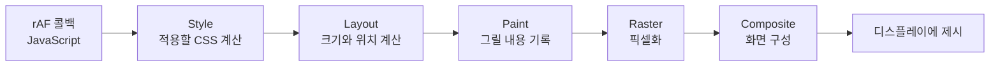

import Callout from '@/components/Callout.astro';

`setInterval(fn, 16)`으로 애니메이션을 만들면 60Hz 화면에서 대략 한 프레임마다 갱신할 수 있을 것처럼 보인다. 그런데 타이머가 16ms마다 실행되더라도 브라우저가 그 순간 화면을 그리는 것은 아니다. 상자의 위치를 바꾸는 코드가 실행돼도, 브라우저가 그 변경을 실제 화면으로 만드는 일은 그 뒤에 남아 있다. JavaScript 실행, 스타일 계산, 레이아웃, 그리기와 합성이 제때 끝나야 다음 화면 갱신에 반영된다.

이 과정에서 `requestAnimationFrame`(이하 rAF)은 **화면을 갱신하기 전에 JavaScript로 값을 바꿀 기회**를 준다. **애니메이션의 타이밍을 브라우저에 맡길 수 있다는 점이 핵심이다.** 화면을 그릴 준비가 된 시점을 브라우저가 고르므로, 개발자가 `16ms`라는 숫자를 화면 주기에 맞춰 추측할 필요가 줄어든다. 다만 rAF를 쓴다는 사실만으로 60 FPS가 보장되거나, 모든 프레임이 전체 렌더링 파이프라인을 거치는 것은 아니다.

## rAF는 한 번 예약하고, 한 번 실행된다

`requestAnimationFrame(callback)`은 브라우저가 다음 화면 갱신을 준비할 때, **다음 페인트 전에** 콜백을 호출해 달라는 요청이다. 예를 들어 상자를 움직인다면 “다음에 화면을 그릴 차례가 오면, 그 전에 위치를 바꾸는 함수를 실행해줘”라고 브라우저에 맡기는 셈이다. 함수가 실행됐다고 화면에 즉시 표시되는 것은 아니고, 브라우저는 그 뒤에 필요한 그리기 작업을 이어간다.

`setInterval`처럼 등록해 둔 함수가 자동으로 반복되지는 않는다. 매번 다음 콜백을 다시 예약해야 한다.

```js
function tick(timestamp) {
  // timestamp를 기준으로 이번 프레임의 화면 상태를 계산한다.
  requestAnimationFrame(tick);
}

requestAnimationFrame(tick);
```

여기서 `timestamp`는 rAF가 제공하는 시간값이다. 프레임마다 일정한 픽셀 수를 더하면 120Hz 화면에서는 60Hz 화면보다 애니메이션이 두 배 빨라질 수 있다. 예를 들어 콜백마다 5px씩 움직이면 1초에 60번 호출될 때는 300px, 120번 호출될 때는 600px 이동한다.

경과 시간으로 위치를 계산하면 콜백 간격이 달라져도 같은 시간에 같은 위치에 도달한다. 백그라운드 탭에서는 rAF가 대개 멈추므로, 콜백 횟수를 실제 경과 시간으로 취급해서도 안 된다.

다음 예시는 화면에 `.moving-box` 요소가 있다고 가정한다.

```js
const box = document.querySelector('.moving-box');
let startedAt = null;

function move(timestamp) {
  if (startedAt === null) startedAt = timestamp;

  const progress = Math.min((timestamp - startedAt) / 1000, 1);
  box.style.transform = `translateX(${progress * 240}px)`;

  if (progress < 1) requestAnimationFrame(move);
}

requestAnimationFrame(move);
```

이 예시는 1초 동안 240px 이동한다. 시작 후 500ms가 지났다면 `progress`는 0.5이고 상자는 120px 지점에 놓인다. 콜백이 한두 번 늦어지면 중간 위치를 건너뛸 수는 있지만, 프레임 번호에 따라 이동하는 코드처럼 전체 애니메이션 시간이 늘어나지는 않는다. 필요하다면 rAF가 돌려준 ID를 보관해 `cancelAnimationFrame(id)`로 중단할 수도 있다.

## VSync와 브라우저의 렌더링 기회

60Hz 디스플레이는 약 16.67ms마다, 120Hz 디스플레이는 약 8.33ms마다 화면을 갱신한다. 60Hz는 화면이 새 내용을 보여줄 **기회가** 1초에 60번 있다는 뜻이지, 브라우저가 반드시 서로 다른 화면 60장을 만든다는 뜻은 아니다.

VSync는 화면 갱신과 새 프레임의 제시 시점을 맞추는 개념이다. 브라우저는 운영체제와 디스플레이 환경의 타이밍을 참고해 렌더링 기회를 정하고, 그 과정에서 rAF 콜백을 실행한다.

이를 **모니터가 매번 rAF를 직접 호출한다**는 고정된 호출 체인으로 이해하면 오해가 생긴다. HTML 표준은 렌더링 기회를 선택하는 한 가지 모델을 강제하지 않는다. 예를 들어 120Hz 화면을 쓰더라도 다른 탭으로 전환하면 해당 페이지의 rAF는 멈추거나 느려질 수 있다. 탭의 가시성, 기기 상태, 브라우저의 조절 때문에 콜백 빈도는 화면 주사율보다 낮아질 수 있다.

`setInterval(fn, 16)`은 16ms라는 **시간 간격**을 요청할 뿐이다. 타이머가 화면 갱신 직후에 실행되면 위치를 바꿔도 그 순간은 이미 지나갔으므로, 다음에 그릴 기회를 기다려야 한다. 메인 스레드의 다른 작업 때문에 타이머 자체가 늦어질 수도 있다.

rAF는 브라우저가 페인트를 준비하는 타이밍에 맞춰 콜백을 호출한다. 그래도 콜백 안의 작업이 길면 프레임을 놓친다. 화면을 그리는 일과 무관한 주기적 작업이라면 타이머가 여전히 적합할 수 있다.

## 콜백 이후 화면까지: 픽셀 파이프라인

rAF 콜백은 **필요한 상태나 스타일을 바꾸는 시점**이다. 가령 콜백에서 상자의 `width`를 바꾸면 JavaScript가 끝난 뒤에도 브라우저는 새 너비가 주변 요소의 위치에 영향을 주는지 계산해야 한다. 콜백이 끝나면 브라우저는 이런 변경을 반영하기 위해 필요한 렌더링 작업을 한다. 다음 그림은 변화가 레이아웃과 페인트까지 필요한 경우의 개념적인 흐름이다.



**Style**에서는 요소에 적용되는 CSS 규칙과 최종 스타일을 계산한다. **Layout**에서는 요소의 크기와 위치를 정한다. 상자의 너비가 늘어나면 옆에 있던 요소가 밀려나는지 판단하는 일이 여기에 해당한다.

**Paint**에서는 글자, 배경, 테두리 등을 어떻게 그릴지 기록하고, **Raster**에서는 그 기록을 픽셀 데이터로 만든다. 그리기 지시서를 작성하는 일과 그 지시서대로 실제 픽셀을 채우는 일을 나누어 생각하면 이해하기 쉽다. **Composite**는 이렇게 만들어진 결과를 겹치는 순서에 맞춰 최종 화면으로 구성한다.

각 단계를 CPU와 GPU로 딱 잘라 나눌 수는 없다. JavaScript와 DOM 관련 스타일·레이아웃은 보통 렌더러 메인 스레드에서 처리한다. Chromium에서는 별도 컴포지터 스레드와 GPU 프로세스가 래스터화·합성에 참여하지만, 장치나 환경에 따라 CPU 대체 경로도 있다.

그래서 “Paint 다음은 전부 GPU가 담당한다”처럼 외우기보다, **메인 스레드에서 할 일이 얼마나 남았는지**와 다른 스레드가 맡을 수 있는 일을 구분하는 편이 낫다. 메인 스레드와 컴포지터가 일부 작업을 병렬로 진행할 수도 있다.

| 변경 예시 | 일반적으로 필요한 경로 |
| --- | --- |
| `width`, `left`처럼 기하 정보 변경 | Style → Layout → Paint → Composite |
| `color`, `box-shadow`처럼 그리기 변경 | Style → Paint → Composite |
| 조건이 맞는 `transform`, `opacity` 변경 | Style → Composite 중심 |

이 표는 작업을 줄일 수 있는 경로를 설명한다. 예를 들어 `width`를 바꾸면 주변 요소의 배치도 달라질 수 있지만, 이미 그려진 상자를 `transform`으로 옮길 때는 그 결과를 재활용할 여지가 있다.

실제로 어느 단계가 다시 실행되는지는 요소와 브라우저의 상태에 달려 있다. `transform`을 선택해도 rAF 콜백에서 무거운 JavaScript를 실행하면 메인 스레드가 막힐 수 있다. 반대로 CSS 애니메이션이나 스크롤처럼 JavaScript 콜백 없이 화면이 바뀌는 경우도 있다.

## 프레임 예산과 버퍼: 16.67ms가 모두 내 시간은 아니다

60Hz라면 갱신 주기는 약 16.67ms다. 그 안에서 내 rAF 콜백뿐 아니라 브라우저의 스타일·레이아웃·페인트 작업과 다른 실행도 처리해야 한다. 콜백이 12ms를 썼다면 남은 약 4.67ms 안에 필요한 다른 일도 끝나야 하는 셈이다.

따라서 **JavaScript에 16ms를 써도 된다**는 뜻이 아니다. 120Hz에서는 주기 자체가 약 8.33ms로 줄어든다.

다음은 60Hz를 가정한 설명용 타임라인이다. 앞 단계가 일찍 끝나면 뒤 단계에 쓸 시간이 늘어나고, 늦게 끝나면 그만큼 줄어든다는 관계를 보여주기 위한 표다. 수치는 브라우저가 보장하는 실행 순서나 실제 소요 시간이 아니다.

| 상대 시점 | 예시 상황 |
| --- | --- |
| 0ms 부근 | 브라우저가 렌더링 기회를 얻고 rAF 콜백 실행 |
| 0~4ms | JavaScript가 요소의 위치를 갱신 |
| 4~10ms | 필요한 Style·Layout·Paint 작업 수행 |
| 10~16ms | 래스터화·합성을 거쳐 새 화면을 준비 |
| 다음 갱신 시점 | 준비된 결과를 화면에 제시할 수 있음 |

새 화면을 만드는 동안 사용자는 이전 화면을 계속 본다. 이를 설명할 때 **앞 버퍼에는 현재 화면, 뒤 버퍼에는 새 화면을 준비한다**는 더블 버퍼링 모델을 많이 쓴다. 한 장을 보여주는 동안 다른 한 장을 준비한다고 생각하면 된다. 완성된 결과를 적절한 갱신 시점에 바꾸어 표시하면 화면이 중간 상태로 찢어져 보이는 현상을 피할 수 있다.

다만 실제 브라우저와 운영체제는 여러 버퍼와 단계별 병렬 처리를 사용할 수 있으므로, “rAF가 실행된 정확히 다음 VSync에 반드시 표시된다”는 규칙으로 받아들이면 안 된다.

<Callout theme="warning" title="rAF는 프레임 완성을 보장하지 않는다">
  콜백이 제때 시작해도 JavaScript나 이후 렌더링 작업이 길면 해당 갱신 시점에 새 화면을 제시하지 못한다. rAF는 화면 갱신과 맞춰 작업할 기회이지, 프레임 드랍을 자동으로 없애는 기능은 아니다.
</Callout>

## FPS를 세면 무엇을 알 수 있을까?

가장 간단한 관측은 1초 동안 rAF 콜백이 몇 번 호출되는지 세는 것이다. 화면이 부드럽지 않을 때 “내 콜백은 대략 얼마나 자주 실행되고 있지?”라는 첫 질문에 답하는 방법이다. `performance.now()`를 따로 호출해도 되지만, 아래에서는 콜백이 제공하는 `timestamp`를 사용한다.

```js
let windowStart = null;
let frames = 0;
let rafId;

function measure(timestamp) {
  if (windowStart === null) {
    windowStart = timestamp;
  } else {
    frames++;
  }

  const elapsed = timestamp - windowStart;
  if (elapsed >= 1000) {
    console.log(`${Math.round((frames * 1000) / elapsed)} rAF callbacks/s`);
    windowStart = timestamp;
    frames = 0;
  }

  rafId = requestAnimationFrame(measure);
}

rafId = requestAnimationFrame(measure);
// 측정을 끝낼 때: cancelAnimationFrame(rafId);
```

이 숫자는 **rAF 콜백 빈도**다. 콜백이 1초에 60번 실행돼도 매번 같은 위치를 설정했다면 사용자가 보는 화면은 바뀌지 않았을 수 있다. 따라서 실제로 새 픽셀이 화면에 제시된 횟수와 같다고 단정할 수 없다. 백그라운드 탭이나 가변 주사율 환경에서는 콜백 간격만으로 프레임 드랍을 판정하기도 어렵다.

Long Task는 메인 스레드를 50ms 이상 붙잡는 작업을 가리킨다. 하지만 60Hz 화면에서는 30ms짜리 작업 하나만 있어도 16.67ms의 갱신 주기를 넘길 수 있다. Long Task가 기록되지 않았다고 해서 끊김이 없었다고 결론 내릴 수 없는 이유다.

반대로 콜백 간격이 16.67ms를 넘었다는 사실만으로 원인이 Long Task인지, 브라우저가 갱신 빈도를 조절했는지 알 수 없다. 원인을 찾을 때는 Chrome DevTools Performance 기록에서 스크립트·렌더링 작업을 함께 봐야 한다.

<Callout theme="note" title="React Scheduler의 yield와는 다른 문제">
  React Scheduler의 `shouldYieldToHost`는 오래 실행한 작업을 양보할지 판단한다. 공개 소스는 이 판단이 프레임 경계에 맞추려는 것은 아니며, 프레임에 맞춰야 하는 작업에는 rAF를 쓰라고 설명한다. 따라서 Scheduler가 항상 16ms의 프레임 예산을 보장한다고 해석하면 안 된다.
</Callout>

## 실제 애니메이션에서 기억할 점

rAF는 다음 페인트 전에 상태를 바꿀 때 사용하고, 반복하려면 다음 호출을 직접 예약한다. 이동량은 콜백 횟수가 아닌 `timestamp`의 경과 시간으로 계산한다. 비용이 큰 Layout·Paint를 매 프레임 유발하는 속성은 먼저 의심하고, 가능한 경우 `transform`이나 `opacity`를 활용한다. 그래도 끊긴다면 콜백 빈도만 보지 말고 DevTools에서 **어느 작업이 프레임 예산을 쓰는지** 확인해야 한다.

앞서 정리한 프론트엔드 성능 측정 글의 Long Task와 사용자 경험 지표도 이때 함께 볼 수 있다. 화면이 한 번 그려지는 과정과 사용자가 실제로 느끼는 반응 시간은 연결돼 있지만, 하나의 FPS 숫자로 모두 설명되지는 않는다.

## References

- [MDN: Window.requestAnimationFrame()](https://developer.mozilla.org/en-US/docs/Web/API/Window/requestAnimationFrame)
- [WHATWG HTML Standard: Rendering opportunity](https://html.spec.whatwg.org/multipage/webappapis.html#rendering-opportunity)
- [web.dev: Rendering performance](https://web.dev/articles/rendering-performance)
- [web.dev: Jank busting for better rendering performance](https://web.dev/articles/speed-rendering)
- [Chrome for Developers: RenderingNG architecture](https://developer.chrome.com/docs/chromium/renderingng-architecture)
- [web.dev: How to create high-performance CSS animations](https://web.dev/articles/animations-guide)
- [web.dev: Towards an animation smoothness metric](https://web.dev/articles/smoothness)
- [MDN: Long animation frame timing](https://developer.mozilla.org/en-US/docs/Web/API/Performance_API/Long_animation_frame_timing)
- [React Scheduler 소스](https://github.com/facebook/react/blob/main/packages/scheduler/src/forks/Scheduler.js)
- [관련 글: 현대 프론트엔드의 성능 측정과 분석](/articles/performance/frontend-datadog-guide/)
